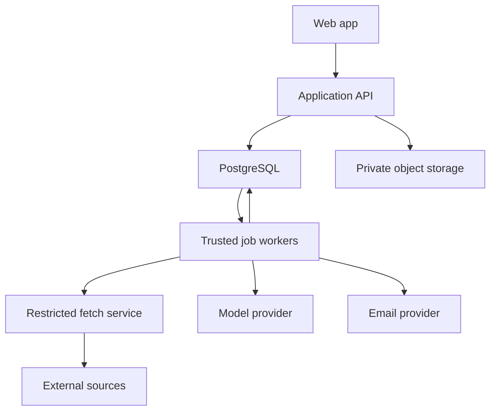
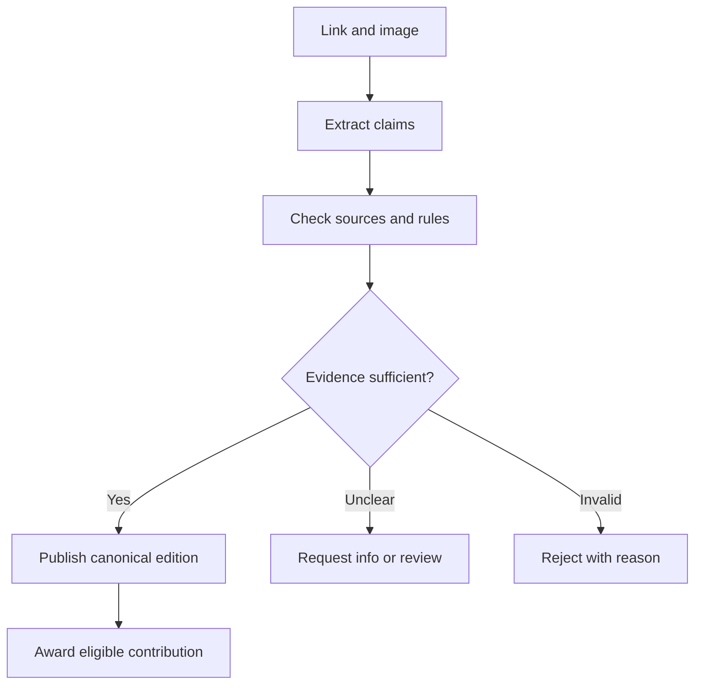

# OCCASIO — Claude Code implementation handoff

Version 1.0 · 3 November 2026 · Founder context + complete planning baseline + current design direction

> **Read Part I before the appendices.** The latest decision is **original lime green + dark neutral backgrounds + a very beautiful bento UI**. Preserve green brand areas. Replace white/grey interface backgrounds with charcoal. Do not resurrect the earlier deep-green brand palette or the earlier Paper-first interface.
>
> This is an implementation brief. The product is not being claimed as built or deployed. Figma contains editable design assets and example screens. The engineering master plan is included in full in Appendix A; a consolidated brand guide is included in Appendix B.

## Read order

1. Part I, sections 1–6: what to build, what changed, Figma references, and bento direction.
2. Part I, sections 7–16: implementation contracts, delivery sequence, validation, and operating rules.
3. Appendix A: complete 26-section product/technical master plan, including architecture, schema inventory, workflows, security, operations, costs, roadmap, and references.
4. Appendix B: brand identity guide with the latest neutral-background correction applied.
5. Before implementation, save the complete contents of this handoff, including both appendices, into the repository-root `agent.md`. Keep the named source documents under `docs/` as specified in section 14.1.

---

# Part I — Current implementation directive

## 1. Mission and scope

Build **OCCASIO**, an opportunity exchange hub.

People register, share an opportunity, receive a relevant opportunity in return, and get help following through on applications. A contribution can be a hackathon, scholarship, grant, fellowship, job, internship, competition, accelerator, event, or other legitimate application-based programme.

The founder's original flow:

1. Register.
2. Submit an opportunity with an application link and an image/poster as reference.
3. AI reads the material, checks the source, confirms the opportunity exists and applications have not passed, and validates details.
4. The user tells the assistant what kind of opportunity they want.
5. Return a relevant opportunity.
6. Accepted opportunities enter a shared opportunity bank.
7. The platform independently discovers opportunities by scanning/searching/scraping the web and runs them through the same checks.
8. Users save opportunities, manage requirements and application progress, and receive reminders before deadlines.

**The entire loop matters:** submit → verify → earn → match → redeem → prepare → track → remind.

A beautiful landing page alone does not complete this task. Neither does a dashboard whose actions only change local mock state. Build the product in tested, functioning increments.

### What OCCASIO promises

- “We help each other win.”
- “Share an opportunity. Find your next.”
- “Your next opening.”
- Useful matching, evidence, freshness, and application follow-through.

### What it must never claim without evidence

Guaranteed legitimacy, guaranteed eligibility, guaranteed funding, guaranteed selection, guaranteed email delivery, or confirmed application submission merely because a user opened an external link.

## 2. Decision history and precedence

This section prevents old references from sending implementation in the wrong direction.

| Stage | Decision | Current status |
|---|---|---|
| Product definition | Opportunity exchange + AI validation + bank + autonomous discovery + application management | Confirmed |
| Naming | OCCASIO | Confirmed |
| Brand audience | Everyone hungry for an opportunity; youthful expression | Confirmed |
| Brand references | Airbnb, Discord, Apple: quality of symbols, personality, and product experience | Inspiration only; never copy their marks |
| Initial explorations | Counterform, Interlock, Moment | Only Moment selected |
| Selected identity | Third concept, Moment; colors from second concept | Confirmed |
| Intermediate palette | A deeper shade of green | Explicitly superseded |
| Palette reversal | Return to original bright green/lime | Confirmed: #D4F812 |
| Background correction | White/grey backgrounds made visibility difficult; founder asked to darken them | Confirmed: charcoal neutrals |
| Incorrect interpretation | Removing large green areas and reducing green to tiny accents | Rejected; green areas were restored |
| Latest UI direction | “BentoUI” / “very beautiful bento” | Confirmed design requirement; see section 5 |
| Mascot | Personality through typography, shapes, and motion | No mascot |

**Conflict order:**

1. The founder's latest explicit instructions and this current directive.
2. Current Figma artwork and inspected resolved values, interpreted with the latest instructions.
3. Consolidated brand guide in Appendix B.
4. Original engineering master plan in Appendix A for detailed product and technical proposals.
5. Earlier boards and earlier descriptions only as historical references.

The original engineering plan predates brand creation. Any statement in it that “brand design is not completed” is historical: editable brand assets and example layouts now exist in Figma. Its audience, staffing, budget, credit rules, timeline, and provider choices remain **proposals**, not newly confirmed founder decisions.

The written brand guide was still Paper-first when retrieved. It is being updated as OCCASIO_Brand_Identity.md alongside this handoff; Appendix B contains the same consolidated guide. Both must follow the original-lime-plus-charcoal direction.

### Confirmed versus proposed

| Confirmed by founder | Proposed implementation default |
|---|---|
| Exchange opportunities | One accepted new edition earns one noncash credit |
| Link + image reference in intended submission flow | Required application link; optional image, fully supported in the UI |
| AI checks existence and whether still open | Evidence-backed publication gate with human review for uncertainty |
| AI independently discovers opportunities | Bounded approved-source registry, then broader discovery |
| Match what users ask for | Hard eligibility filters + ranking + grounded explanation |
| Help users apply before deadlines | Persistent reminders + queue; in-app and email first |
| Audience is everyone hungry for opportunity | Initial categories and acquisition cohorts can be narrower experiments |
| Very beautiful bento interface | Custom responsive CSS Grid using accessible UI primitives |
| Green identity and darker neutral backgrounds | Exact semantic tokens in section 4 |

Put proposals in versioned configuration or ADRs. Use reversible defaults to keep building. Do not silently invent subscription pricing, domain ownership, a production budget, extra social networks, or an automatically submitting agent.

## 3. Figma and source directory

**Figma file:** [OCCASIO](https://www.figma.com/design/M5P0Eq8eEM2EhVWnZGTLRc/OCCASIO?node-id=8-2)  
**File key:** `M5P0Eq8eEM2EhVWnZGTLRc`  
**Start frame:** `8:2`

The page directory and core semantic token values were read from the live file while preparing this handoff. Node IDs are navigation references; resolve names if later edits change them.

| Page | Page node | Purpose |
|---|---|---|
| 00 · Start here | 0:1 | Identity overview and navigation |
| 01 · Strategy & voice | 3:2 | Positioning, tone, messaging |
| 02 · Logo masters | 3:3 | Editable symbol, wordmark, horizontal/stacked and monochrome families |
| 03 · Logo usage | 3:4 | Clear space, minimum size, correct/incorrect use |
| 04 · App icons & exports | 3:5 | App tiles, favicon proofs, export presets |
| 05 · Color system | 3:6 | Original lime and current background rules |
| 06 · Typography | 3:7 | Manrope roles and typography system |
| 07 · Shapes, grids & icons | 3:8 | Brand shapes, layout foundations, functional icons |
| 08 · UI components | 3:9 | Buttons, fields, notices, states, reusable controls |
| 09 · Opportunity & tracker cards | 3:10 | Catalog, credit, and application card patterns |
| 10 · Mobile — onboarding | 3:11 | Welcome, registration/preferences and initial flow |
| 11 · Mobile — exchange | 3:12 | Contribution, checking, acceptance, matching, no-fit states |
| 12 · Mobile — applications | 3:13 | Saving, preparing, tasks, application progress and reminders |
| 13 · Website & responsive | 3:14 | Desktop, tablet/mobile and public/product layouts |
| 14 · Social & campaigns | 3:15 | Campaign square, promotional and social templates |
| 15 · Email & notifications | 3:16 | Email and notification layouts |
| 16 · Stationery & merchandise | 3:17 | Print, business card, poster and merchandise treatments |
| 17 · Motion & prototypes | 3:18 | Motion principles and native reveal |
| 18 · Accessibility & handoff | 3:19 | Implementation notes, accessibility and export guidance |

### Useful direct design targets

Every link uses the same OCCASIO file.

| Target | Node | Link |
|---|---|---|
| Overview | 8:2 | [Open](https://www.figma.com/design/M5P0Eq8eEM2EhVWnZGTLRc/OCCASIO?node-id=8-2) |
| Green brand cover | 8:7 | [Open](https://www.figma.com/design/M5P0Eq8eEM2EhVWnZGTLRc/OCCASIO?node-id=8-7) |
| Logo master board | 4:2 | [Open](https://www.figma.com/design/M5P0Eq8eEM2EhVWnZGTLRc/OCCASIO?node-id=4-2) |
| Color board | 8:274 | [Open](https://www.figma.com/design/M5P0Eq8eEM2EhVWnZGTLRc/OCCASIO?node-id=8-274) |
| Exchange screens | 9:205 | [Open](https://www.figma.com/design/M5P0Eq8eEM2EhVWnZGTLRc/OCCASIO?node-id=9-205) |
| Exchange, first three screens | 9:210 | [Open](https://www.figma.com/design/M5P0Eq8eEM2EhVWnZGTLRc/OCCASIO?node-id=9-210) |
| Applications | 9:363 | [Open](https://www.figma.com/design/M5P0Eq8eEM2EhVWnZGTLRc/OCCASIO?node-id=9-363) |
| Responsive website | 9:535 | [Open](https://www.figma.com/design/M5P0Eq8eEM2EhVWnZGTLRc/OCCASIO?node-id=9-535) |
| Native reveal | 10:245 | [Open](https://www.figma.com/design/M5P0Eq8eEM2EhVWnZGTLRc/OCCASIO?node-id=10-245) |
| Accessibility/handoff | 10:262 | [Open](https://www.figma.com/design/M5P0Eq8eEM2EhVWnZGTLRc/OCCASIO?node-id=10-262) |

### Logo master IDs

| Treatment | Symbol | Wordmark | Horizontal | Stacked |
|---|---|---|---|---|
| Primary | 4:10 | 4:13 | 4:16 | 4:23 |
| Ink | 4:32 | 4:35 | 4:38 | 4:45 |
| Paper/reversed | 4:54 | 4:57 | 4:60 | 4:67 |

Export the actual vectors. The wordmark is custom outlined artwork, not typed Manrope. Keep its interacting uppercase letters and the O–C–C symbol's oval counter and curved cuts.

Previous work reported 87 main components, 23 screen layouts, and 12 text styles. These are a historical inventory snapshot, not a new count or a requirement to recreate exactly that number. Inspect current assets and use what is relevant.

### Design-to-code workflow

1. Read Figma design context and screenshots before coding each major route.
2. Inspect components, tokens, typography, spacing, and variants; reuse the same visual vocabulary.
3. Export genuine SVG logos, app icons and required supporting assets into the repository.
4. Build semantic HTML and reusable components. Never implement a screen as a background screenshot.
5. Adapt the supplied screens into a richer bento composition as requested below, preserving brand assets, workflow meaning, and current palette.
6. Compare browser renders against Figma references and the bento acceptance criteria.
7. If Figma access is unavailable, build the product structure and token system, document the asset blocker, and avoid fabricated replacement logos. Do not claim an export or visual comparison was completed.

There is no known existing Code Connect mapping or repository associated with this handoff. Inspect the supplied working directory before assuming the project is empty or creating a new repository.

### Original source files

- [Original complete master plan](https://chatgpt.com/library?file_id=libfile_6fb8f995a7948191ac2549d8f3d79346&account_id=personal)
- [Updated brand guide — OCCASIO_Brand_Identity.md](https://chatgpt.com/library?file_id=libfile_e9fadf1d9a988191886e696eaf956b89&account_id=personal) — original lime retained, charcoal neutral backgrounds, current bento direction.
- [Identity exploration board](https://chatgpt.com/library?file_id=libfile_b43640d7b6388191ad653a80e6c6954c&account_id=personal) — only selected Moment geometry carries forward.
- [Earlier Moment identity board](https://chatgpt.com/library?file_id=libfile_ccb0df9a9e4881919f0920121fb67bc2&account_id=personal) — historical raster reference; deep-green treatment superseded.
- [Earlier identity-in-use board](https://chatgpt.com/library?file_id=libfile_38756f702f48819197b22375d7a0bcd6&account_id=personal) — historical raster reference.

Claude Code may not be able to open ChatGPT account links. This document embeds the complete master plan and consolidated brand guide so implementation does not depend on those links. It does not embed or bundle Figma vector exports or the historical images.

## 4. Current brand and semantic colors

### Core identity

**Name:** OCCASIO, uppercase in the brand signature.  
**Selected identity:** Moment.  
**Audience:** Everyone hungry for an opportunity.  
**Energy:** Youthful, curious, generous, resourceful, confident.  
**First impression:** “Wow, I'm curious.”  
**Personality:** Delivered through type, shapes, interaction, and motion.  
**Voice:** Globally neutral, conversational, concise, specific.  
**Exchange symbolism:** Subtle, discoverable through interacting forms; no literal opposing-arrow logo.

No blue, purple, gradients, stars/sparkles, bot icons, books, pens, graduation/student icons, mascots, or generic AI decoration. Functional icons are allowed, but must be restrained and useful.

### Current tokens — build these first

| CSS token | Figma semantic variable | HEX | Use |
|---|---|---|---|
| --color-brand | color/brand | #D4F812 | Original lime: primary actions and preserved green brand areas |
| --color-brand-shade | palette/olive | #B8D912 | Lime shade, supporting accents |
| --color-on-brand | color/onBrand | #151812 | Text/icons on lime |
| --color-bg | color/surface | #151812 | Main charcoal page canvas |
| --color-panel | color/panel | #282D23 | Dark neutral card/panel |
| --color-subtle | color/subtle | #35412A | Subtle green surface or secondary control |
| --color-text | color/text | #F6F4EC | Main reading text on dark backgrounds |
| --color-text-secondary | color/secondary | #C6CEBC | Supporting text on dark backgrounds |
| --color-border | color/border | #87927B | Visible borders for controls and important boundaries |
| --color-paper | palette/paper | #F6F4EC | Primitive/reversed artwork; not the default app canvas |
| --color-lime-tint | palette/sage | #F0F4DA | Retained brand primitive/swatch; not the default reading canvas |

**Figma migration detail:** The mode originally named “Light” (mode ID 3:1) now contains the approved dark-neutral values. Do not assume the mode label describes the current design. Map the resolved values above to code semantics. Do not automatically follow the OS light preference and restore white/grey backgrounds. A light theme is not required for this build.

The second Figma mode has some different border/secondary aliases. Treat the table above as the approved default implementation theme. A separate alternate theme needs its own deliberate design validation.

```css
:root {
  color-scheme: dark;
  --color-brand: #d4f812;
  --color-brand-shade: #b8d912;
  --color-on-brand: #151812;
  --color-bg: #151812;
  --color-panel: #282d23;
  --color-subtle: #35412a;
  --color-text: #f6f4ec;
  --color-text-secondary: #c6cebc;
  --color-border: #87927b;
  --font-sans: "Manrope", ui-sans-serif, system-ui, sans-serif;
}
```

Keep green heroes, campaign panels, app tiles, brand graphics and lime actions green. Do not repeat the earlier mistake of removing green from large areas. Conversely, do not fill every content panel with lime; distinguish intentional green compositions from ordinary neutral backgrounds.

Text on lime is Ink. Text on charcoal is Paper or the secondary neutral. Use local foreground/background pairings rather than a global “make all text white” override. The same applies to logo variants and essential icons.

Ink on original lime is approximately 14.71:1. Recalculate implemented pairings with their actual opacity and background; color-pair ratios alone do not establish complete accessibility.

### Type, spacing, shape, motion

- Product/UI font: Manrope, self-hosted where practical, with the actual distribution license retained.
- Custom Moment artwork for the wordmark; no font substitution.
- Body 16/25 px, metadata around 14/20 px, controls 15/20 px; never shrink critical dates into faint microcopy.
- Hero starting point: 64/68 px desktop, 40/44 px mobile; adjust to actual content.
- 4 px spacing base; 8, 12, 16, 24, 32, 48, 64 common steps.
- Card radius around 16 px; large bento panels 20–24 px; controls around 10 px.
- Solid surfaces, deliberate borders, generous space, clear alignment.
- UI transitions about 140–220 ms; panels 220–300 ms.
- Logo reveal about 450–650 ms at an intentional brand moment; not on every navigation.
- Reduced-motion alternatives. No confetti, spinning mascots, bouncing tiles, particle bursts, or shimmer that never ends.
- Green brand layouts can use the symbol's counterforms and intentional crops. Never crop the primary identifying logo accidentally.

## 5. Bento UI specification

The founder explicitly requested a **very beautiful bento UI**. This is a product design requirement, not an instruction to install an arbitrary package named BentoUI. Use existing repository conventions and accessible primitives; implement the layout deliberately.

### Visual intent

A designed, editorial bento system: varied but orderly card spans, strong typography, purposeful space, a confident green anchor tile, and quiet dark content panels. Each tile has a job. The result should feel like a carefully designed consumer product rather than a generated admin template.

Use Figma's identity and components as the source vocabulary. The latest bento instruction allows composition improvements beyond the existing examples; it does not authorize changing the logo, palette, product rules, or content hierarchy.

### Layout starting specification

| Context | Grid | Gap | Typical behavior |
|---|---|---|---|
| Wide desktop | 12 columns | 24 px | Feature panel 7–8 cols, supporting rail 4–5 cols; balanced second row |
| Laptop/tablet landscape | 8 columns | 20 px | Main task 5 cols, support 3; simplify optional tiles |
| Tablet portrait | 6 columns | 16–20 px | Main content full width; smaller summaries paired where readable |
| Mobile | 1 column; optional 2-col small summaries | 16 px | Logical task order, full-width actionable cards, no squeezed text |

These are starting proposals, not claims about current Figma grid values. Let content and accessibility determine breakpoints. Keep DOM/focus order aligned with visual reading order. Avoid dense grid packing that reorders meaning.

Suggested desktop content max-width 1280–1440 px; mobile padding 16–20 px; desktop padding 24–40 px. Use minmax(0, 1fr), flexible content, and intrinsic sizing to avoid overflow. Do not impose a fixed tile height on long opportunity titles or requirements.

### Home/dashboard bento

| Tile | Starting span | Content/action | Required state behavior |
|---|---|---|---|
| Your next opening | 7–8 / 12 | One high-quality matched opportunity or a clear request-a-match action | No eligible result preserves credit and explains next step |
| Make space for someone | 4–5 / 12 | Green contribution tile with Share an opportunity | Pending contribution, upload retry, or no contribution yet |
| Coming up next | 5–6 / 12 | Upcoming target dates and official deadlines, clearly distinguished | Empty state teaches saving/planning; expired items labeled |
| My applications | 3–4 / 12 | Current preparation progress and next task | User-owned data; progress derived from real tasks |
| Exchange balance | 2–3 / 12 | Credits available and link to history | No gambling presentation, fake growth chart or unearned points |
| Recent discoveries | Full or balanced row | Fresh bank previews or already-unlocked opportunities | Truthful source/checked time; no invented live content |

Prioritize one main task. This is not a mandate to show six tiles to every first-time user. Use actual account state to choose useful content.

### Public landing bento

- Header with the exported horizontal logo.
- Hero headline “Your next opening.”
- Short explanation of sharing, finding a fit, and making time to apply.
- Clear share/discover actions.
- A large green identity tile with the real Moment artwork.
- A content-led tile demonstrating opportunity details and evidence.
- An application-preparation tile with an honest sample state.
- Three coherent steps: Share → Exchange → Act.
- Real product UI examples or labeled samples, never fake traction metrics, partner logos, testimonials or live activity feeds.
- Responsive cards with a deliberate mobile reading sequence.
- Useful footer: contact/support, terms/privacy, community/source policy when implemented.

### Discovery, detail, contribution and tracker

**Discovery:** A bento-like content layout around search, a filter strip/panel, featured results, and ordinary cards. Standard results should remain scannable; do not vary every result's size so comparisons become difficult.

**Opportunity detail:** Main content panel for organizer, description, benefits and eligibility; adjacent action/deadline panel; source/freshness and requirements panels. Display uncertainty where the user makes the decision.

**Contribution:** A useful stepwise form: link and poster → extracted details → verification progress/result. Use supporting panels for what earns credit and what happens next. Preserve drafts and progress.

**Applications:** A workspace combining the next task, upcoming deadlines, a progress overview, and list/board view. Lists remain available for accessibility and mobile use. Drag-and-drop is optional and must have keyboard/button alternatives.

**Assistant/matching:** Integrated contextual panel with structured preference chips and match explanations. It should not be an oversized generic chatbot that replaces normal navigation and filtering.

**Admin:** Dense, readable work queues and evidence comparison. Do not force decorative bento layouts onto every table or review workflow.

### Bento component inventory

Implement a reusable layer, not one-off absolute-positioned blocks:

- BentoGrid, BentoTile, TileHeading, TileActions and responsive span utilities.
- AppShell, desktop navigation, mobile navigation, page header and account menu.
- OpportunityCard, OpportunityPreview, DeadlineBadge, SourceEvidence, EligibilitySummary.
- ContributionPanel, UploadDropzone, SubmissionProgress, VerificationNotice.
- MatchPanel, MatchReasonList, ClarificationPrompt, NoMatchState.
- CreditBalance, LedgerList, RefundRequest.
- ApplicationCard/List/Board, TaskChecklist, TargetDatePicker, DeadlineTimeline.
- NotificationItem, NotificationPreferences, EmptyState, ErrorState, LoadingState.
- ReviewQueue, EvidenceComparison, DecisionForm, AuditLog.
- Accessible buttons, links, fields, dialogs, selects, tabs, toasts and tooltips.

Derive the actual component API from the repository and Figma; these names express responsibilities, not a compulsory package structure.

### Interaction quality bar

- Real pending, success, empty, unavailable, retry, offline/interrupted and unauthorized states.
- Visible field labels, actionable errors and retained input on failure.
- Avoid nested buttons/links inside a whole-card link.
- No hover-only information or controls.
- Entire essential flow works by keyboard, including uploads and dialogs.
- Focus ring remains visible on lime and dark surfaces.
- No decorative motion delaying core actions.
- Touch targets around 44 px for important controls; do not shrink icons into tiny tap targets.
- No mobile horizontal scrolling, clipped cards, unreadable metadata or overlap at 320 px and common phone widths.
- Long titles, localization-ready dates, large text, 200% zoom and reflow tested.
- Timed countdowns supplement explicit dates/timezones, never replace them.

## 6. Product surface and route map

Route names are proposed; adapt to existing code without losing coverage.

| Route | Purpose | Essential behaviors |
|---|---|---|
| / | Public bento landing | Explain the loop, clear actions, truthful examples |
| /auth/* | Sign up, sign in, email verification, recovery | Managed auth, recovery, safe return URLs |
| /onboarding | Profile and preferences | Interests, location, relevant eligibility, timezone, notification choices |
| /home | Personalized bento workspace | Contribution, useful match, deadlines, next tasks, balance |
| /discover | Bank previews and filters | Category, location, eligibility, deadline, safe query state |
| /opportunities/:id | Preview or entitled detail | Server-side entitlement, evidence, freshness, deadline, report |
| /contribute | Link/image submission | Signed upload, draft, extraction confirmation, asynchronous start |
| /submissions/:id | Processing/result | Pending, needs information, duplicate, accepted, rejected, failed |
| /matches | Preferences and assistant | Clarification, candidates, no-fit, explicit redemption |
| /applications | Private tracker | List/board, filtering, real next steps |
| /applications/:id | Preparation workspace | Checklist, notes, target date, status, reminders |
| /deadlines | Upcoming calendar/list | Local timezone, unknown timezone handling |
| /credits | Balance and immutable history | Awards, spends, refunds, clear reasons |
| /notifications | In-app notifications | Read state, links, actionable messages |
| /settings/* | Account/privacy/preferences | Quiet hours, consent, export/delete, sign out |
| /admin/* | Restricted operations | Review, catalog, sources, jobs, reports, costs, audit |

Marketing/print assets are part of the design system and handoff. They are not extra public app routes or a reason to delay the functional loop.

## 7. Architecture to implement

Use the master plan's proposed **TypeScript modular monolith with independently deployed workers**, PostgreSQL as canonical storage, and a separate restricted fetch service.

Recommended starting choices, subject to actual repository conventions:

| Layer | Default |
|---|---|
| Web/API | Supported stable Next.js + React + TypeScript |
| UI | Tokenized CSS/Tailwind if appropriate; accessible primitives; custom bento composition |
| Validation | Zod/shared schemas |
| Database/auth/storage | Supabase PostgreSQL/Auth/private Storage |
| Queries/migrations | Drizzle plus explicit transactional SQL where needed |
| Jobs | pg-boss with long-running Node workers |
| Search | PostgreSQL structured filters and full-text search initially |
| Retrieval | Restricted HTTP fetcher; isolated browser fallback only when needed |
| AI | Provider adapter for structured extraction, vision, and matching explanation |
| Email | Provider adapter, initially Resend or equivalent |
| Deployment | Separate web, trusted worker and restricted fetch containers |
| Observability | Redacted structured logs, correlation IDs, job metrics, error tracking and cost attribution |

Verify current official documentation and pin compatible supported versions during implementation. This handoff is not a claim about the latest release of any package.

**Runtime caveat:** Long-running pg-boss workers and a browser fetcher cannot simply be placed in a short-lived serverless request handler. Pick a host that supports those processes, or record an ADR and preserve the same durability/security properties with an alternative. Do not quietly replace persistent jobs with browser timers or in-process timeouts.

### Suggested repository boundaries

| Path | Responsibility |
|---|---|
| apps/web | Public site, authenticated UI, API layer |
| apps/worker | Trusted queue consumers, reminder dispatch, verification orchestration |
| apps/fetcher | Restricted external retrieval with no product credentials |
| packages/domain | Product states, rules, exchange and eligibility logic |
| packages/db | Schemas, migrations, transaction helpers, row policies |
| packages/contracts | Validated API/event/job schemas |
| packages/ui | Tokens, accessible primitives and OCCASIO bento components |
| packages/ai | Provider interface, prompts, structured schemas, evaluations |
| packages/sources | Approved-source adapters and extraction contracts |
| packages/config | Validated server configuration and feature flags |
| tests | Integration, concurrency, authorization, end-to-end and AI fixtures |
| docs | This handoff, ADRs, API, runbooks, source policies, build status |
| public/brand | Exported approved logo/icon assets and manifest |

Use a simpler structure if the existing project does not justify a monorepo. Preserve the boundaries even if they are directories in one app.

### Required runtime separations

- Browser code never receives service-role keys, model keys or email credentials.
- Request handlers validate identity and ownership, not just UI visibility.
- Trusted workers own business writes. The fetcher has no database/cloud metadata route or product secrets.
- Model output is untrusted data, validated against schemas and business rules.
- Database state and outbox events commit together.
- Every paid, externally retried or financially analogous mutation has idempotency and business uniqueness constraints.

## 8. Domain contracts that must survive implementation

### State axes

Keep submission processing, publication, availability, trust and eligibility distinct. A reachable website does not prove a legitimate organizer; a previously published opportunity may now be closed.

Suggested processing states:
received → queued → fetching → extracting → validating → accepted / duplicate / needs_information / review_required / rejected / failed.

Canonical publication: draft / review / published / hidden / retired.  
Availability: upcoming / open / closed / rolling / unknown.  
Trust: assessed states and explicit risk flags, with evidence; not a single universal guarantee badge.  
Per-user eligibility: eligible / ineligible / unknown, with reasons and ruleset revision.

Exact enum spelling follows the executable schema and API. Never encode all axes in one vague “verified” boolean.

### Canonical identity and data

Model organizer → programme → edition/round. The same programme next year may be a new creditable opportunity; a tracking URL for the same round is a duplicate.

Use evidence snapshots, field-level evidence, original source wording, source URL, retrieval time, freshness, verification runs, and revisions. Keep submitted/raw material separate from reviewed canonical facts.

Appendix A contains the full table inventory. The minimum transactional slice needs profiles/preferences, submissions/assets, organizers/programmes/opportunities/deadlines/eligibility/sources/evidence, wallets/ledger/awards, match requests/candidates/entitlements, private applications/tasks, reminders/attempts, outbox/receipts, moderation/audit and source registry.

### Credit/exchange implementation defaults

- One accepted new canonical edition earns one credit to the first accepted eligible contributor.
- Discovery-generated records do not mint user credits.
- Duplicates are explained and do not earn another credit.
- No cash value, transfers, purchased balance, or expiry in beta.
- A configurable starter match is a proposed onboarding experiment.
- Creating a match request does not debit a wallet.
- Redemption locks the wallet, rechecks publication/availability/freshness/eligibility, creates a unique entitlement, appends a debit and event, and updates balance in one transaction.
- A permanent entitlement prevents recharging for revisiting the same opportunity.
- No result, missing material eligibility, provider failure, or already-unlocked opportunity means no debit.
- Refunds are compensating ledger entries, not edits to past rows.
- Unique business keys and concurrency tests apply beyond idempotency-key retention.
- No hidden client-side credit computation or editable ledger endpoint.

Hard eligibility unknowns trigger clarification or a noncharged pending result. Do not charge for a guess presented as a known fit.

### Verification

Safe ingestion → source retrieval → image/text extraction → normalized candidate → source comparison → duplicate/edition resolution → deterministic publication gate → human review when uncertain → canonical publication → single award.

Evidence/source text must never become system instructions. Extraction has no privileged tools, no arbitrary SQL, no ability to send messages or mint credits.

Check deadline year, date precision, official organizer/application domain, eligibility, fees, benefits/prizes, redirects, recurring editions, and conflicting image/page facts. Unknown or blocked source access is a state requiring resolution, not permission to invent a valid result.

### Discovery and rechecks

Approved-source registry, access policies, per-source rate limits, robots/terms review, content hashes/conditional retrieval, crawl budget, and stop switches. No login bypasses or unrestricted crawler as a launch prerequisite.

Use the same verification and publication gates as user contributions. Recheck published records based on deadline proximity and risk. Only invoke expensive extraction again when relevant content changes or a policy requires it.

### Application management

Initial statuses: interested/saved → preparing → submitted → result; explicit withdrawn/expired outcomes where appropriate. A user marking “submitted” is a user assertion unless an integration proves it. Keep organizer confirmation separate.

Private notes, tasks, target dates, source deadlines, timezone and revisions. Saving/tracking an unlocked record does not cost more credits.

### Reminder reliability

- Persistent due records + queue + retries + deduplication.
- Explicit source deadline precision and original timezone; never invent midnight UTC.
- Distinguish user target date from official closing date.
- Deadline changes invalidate obsolete future reminders and replan safely.
- Quiet hours must not move a time-sensitive reminder past the actual deadline.
- Stop/replan reminders after submission, withdrawal, closed opportunities, deletion or preference changes.
- Use IANA timezones, test daylight-saving transitions, and handle unknown timezone conservatively.
- Provider accepted ≠ delivered ≠ read. Show delivery uncertainty honestly.
- Do not promise exactly-once delivery when a provider timeout leaves acceptance ambiguous; dedupe/reconcile attempts and expose uncertainty operationally.
- Product automation belongs in backend workers, not ChatGPT reminder tasks.

## 9. API, events, security and privacy

The full endpoint/event inventory is in Appendix A, section 14.

API base: /api/v1. Validate all input. Scope every user operation to authenticated identity. Use cursor pagination, explicit error codes, request IDs, rate limits, revision checks, signed uploads and safe redirects.

Critical endpoints include submissions, status polling, catalog preview/detail, match requests/redeem, wallet/history, applications/tasks, preferences, reports, admin decisions, signed provider webhooks, export and deletion.

Commit domain updates and outbox events in one transaction. Consumers deduplicate event IDs, tolerate repeated delivery, and guard aggregate revisions.

### Release-blocking controls

| Risk | Required implementation |
|---|---|
| Cross-user access | Server ownership checks + database/RLS/storage tests using two distinct accounts |
| Double awards/spends | Transactions, locks and unique constraints; concurrent acceptance/redemption tests |
| SSRF | Every redirect/subresource/DNS destination validated; network-enforced private/metadata isolation |
| Hostile source/poster prompts | Treat as data; schema validation; no privileged extraction tools |
| Unsafe upload | Signature/decode checks, limits, re-encoding, private storage; no executable HTML/SVG uploads by default |
| XSS | Safe text rendering and sanitized allowed rich content/links |
| Forged callbacks | Raw-body signature validation, timestamps and replay/event dedupe |
| Operator misuse | Server-controlled roles, least privilege, MFA where required, reasoned audit trail |
| Secret exposure | Server-only validation, redacted logs, bundle/secret checks |
| Notification privacy | Minimal provider payloads, separate marketing consent, unsubscribe/preferences |
| Account lifecycle | Export/delete workflows covering storage, jobs and provider data |

Do not send whole private profiles or application notes to AI unless needed and explicitly justified. No unnecessary identity documents. Retention proposals and privacy launch work are in Appendix A; do not claim a legal review has happened.

## 10. Local setup and dependency handling

First inspect repository status and instructions. Do not overwrite unrelated work. Record the actual package manager, runtime versions and existing architecture.

Provide:

- A documented install/start path with pinned lockfile.
- Database migrations and least-privilege policies.
- .env.example containing names and descriptions only.
- Separate validated web, worker and fetcher configuration.
- Local seed fixtures labeled as examples.
- Development auth/data setup and deterministic provider fixtures.
- Commands for web, worker, fetcher, test, lint/typecheck/build and evaluations.
- Health/readiness endpoints and graceful worker shutdown.
- Actual deployment/container configuration and runbooks.

Suggested environment roles, adjusted to selected providers:

| Group | Examples | Exposure |
|---|---|---|
| Public app | App origin, Supabase URL/publishable browser key if used | Only explicitly public values |
| Database | Migration URL, app/worker role URLs | Server only; direct/session connections where required |
| Auth/storage | Provider credentials and bucket config | Privileged keys server only |
| AI | Provider key, model identifiers, usage caps | Worker/server only |
| Email | API key, sender, webhook signing secret | Server only |
| Fetch | Restricted service origin, internal auth, source budgets | Server-to-server only |
| Observability | Error/trace configuration and environment label | Separate public-safe versus private values |

Never include real secrets in docs, seeds, screenshots, logs, committed files or final reports. Long-running queue workers must use a compatible database connection mode; verify the chosen provider/pooler behavior.

When credentials are absent, continue independent implementation and use explicit development adapters. Clearly label fixture/demo mode; never present mock verification, fake sends or sample opportunities as live. Keep production entrypoints from silently falling back to fixtures. Report only the concrete provider setup that remains blocked.

## 11. Delivery sequence and acceptance

The original 12–14-week roadmap is an illustrative small-team planning baseline, not a promise about Claude Code speed. Deliver functional milestones in this order.

| Milestone | Deliverable | Done when |
|---|---|---|
| M0 · Grounding | Repo/Figma audit, decisions, asset references, build plan | Existing work preserved; current brand/bento rules captured |
| M1 · Foundation | Tokens, real SVG assets, accessible primitives, bento shell, responsive landing | Current lime + charcoal look implemented and visually checked |
| M2 · Identity/private workspace | Auth, onboarding, profile, tracker ownership | Two-account isolation and recovery paths pass |
| M3 · Complete exchange slice | Submit → fixture/manual review → acceptance → credit → match → redemption → tracker | Atomic DB-backed flow works; no debit on failure |
| M4 · Live evidence and AI | Restricted fetching, OCR/vision/extraction, field evidence, moderation | Supported sources pass evaluations; uncertainty stays visible |
| M5 · Reliable reminders | Persistent planning, dispatch, preferences and provider events | Deadline changes/retries/quiet hours tested |
| M6 · Discovery and freshness | Approved-source ingestion, hashes, revisions and rechecks | Discovery uses identical publication gates and cost caps |
| M7 · Full operational UI | Reviews, catalog/source/job/report/cost/audit views; complete responsive product | Every primary action functional with complete states |
| M8 · Release hardening | Security, accessibility, restore, observability, privacy and deployment checks | Evidence-backed release checklist and honest remaining gaps |

Do not wait until M7 to make UI beautiful. The design system and responsive bento shell start at M1 and improve through every feature.

### First complete slice

A verified user submits a labeled fixture opportunity with a poster/link. A reviewer approves source-backed details. The first accepted new edition awards one credit exactly once. The user requests a suitable match, explicitly redeems it without double-spending, saves it, adds a task/target date, and receives a recorded reminder through a local/test delivery adapter. Repeat under retries and concurrent requests.

Then replace fixture boundaries with evaluated real providers while keeping the same domain contracts.

### Test plan

| Layer | Meaningful cases |
|---|---|
| Domain | Edition/duplicate identity, hard eligibility, deadline precision, state transitions, refund rules |
| Database | Wallet concurrency, double acceptance, entitlement uniqueness, outbox atomicity, isolation |
| Integration | Storage policies, signed uploads, source adapter, model schema failures, webhook replay, job retries |
| Security | Cross-account access, private-network redirects/subresources, hostile posters/pages, unsafe links/uploads |
| Reminders | Deadline revision, quiet hours, user submission, cancellation, duplicate jobs, provider timeout uncertainty |
| E2E | New user → contribution → status → credit → match → redeem → tracker → preferences |
| Visual | Landing/home/discovery/detail/contribution/tracker/admin at desktop and mobile; all real states |
| Accessibility | Keyboard, focus, labels, dialogs, contrast, reduced motion, zoom/reflow and screen-reader smoke tests |
| AI evaluation | Unsupported/closed/scam-risk/duplicate/ambiguous timezone/ineligible/conflicting source fixtures |
| Operations | Restart recovery, backup restore, job replays, source/AI/email stop switches, cost limits |

Use a representative fixture set and test genuine invariants. Do not add hundreds of tests that only mirror component markup. Automated accessibility tooling supplements manual checks; it does not justify an unsupported conformance claim.

## 12. Visual and functional definition of done

### Design

- Original Moment symbol and actual custom wordmark exported from Figma.
- Original #D4F812 lime retained in approved green brand areas and actions.
- White/grey neutral backgrounds replaced by the approved charcoal hierarchy.
- Light text on dark surfaces; Ink text on lime; correct logo variants everywhere.
- Deliberate bento composition with useful tiles, varied hierarchy and balanced space.
- Content stays readable on mobile; no forced desktop grids shrunk into phone width.
- Shared tokens/components across marketing, app, emails and admin where appropriate.
- All visible controls have meaningful actions and appropriate states.
- No generic AI motifs, gradients, blue/purple decoration, fake metrics or stock education symbols.
- Browser comparison evidence recorded for core routes; Figma examples are not flattened into images.

### Product

- Complete real exchange with atomic credits and permanent entitlements.
- Evidence-backed catalog with editions, uncertainty and source freshness.
- User-owned tracker and preparation tasks.
- Persistent reminder pipeline with change handling and operational visibility.
- Bounded autonomous discovery and rechecks.
- Admin review/report/source/job workflows, not only a hidden dashboard link.
- Privacy export/deletion and auth/storage ownership controls.
- Provider failures degrade honestly and do not charge the user.
- Functional filtered search usable without chat.
- Deployable app + durable workers; deployment not claimed until actually verified.

### Delivery evidence

Record commands run and results, screenshots/visual comparisons, migration state, provider/infrastructure setup, evaluation outcomes, known limitations, and exact next steps in docs/BUILD_STATUS.md.

If something was not run, say so. “Production ready” is not a substitute for evidence.

## 13. Planning and operations coverage

The full master plan below carries the original detail. Keep these areas in the actual build:

- Versioned product rules and ADRs.
- Executable schema, data dictionary, migration/rollback process.
- OpenAPI and event/job schema contracts.
- Source registry/access policies, adapter tests and stop switches.
- Prompt/model registry, evaluation fixtures, usage accounting and model fallback rules.
- Trust/review queue, source corrections, scam handling and user reports.
- Notification consent, delivery records, failed-job recovery and incident runbooks.
- Database and object backups, restore drills and documented recovery limits.
- Privacy/security review, operator role ownership and data retention.
- Analytics for contribution acceptance, match fit, redemption, preparation and return behavior.
- Per-source/per-run costs and queue load; prevent AI re-extraction on every unchanged refresh.
- Concierge pilot and staged beta rather than unsupported claims of global coverage.
- Launch gates, operating ownership and a concrete release checklist.

The master plan's illustrative $100–$300 pilot, $300–$1,000 beta and $1,000–$4,000 larger-stage monthly budgets are proposals, not current vendor quotes or founder-approved spending. Re-estimate with actual infrastructure and measured usage before procurement.

## 14. Working rules for Claude Code

### 14.1 Mandatory project context: agent.md

The founder explicitly requires all this context to be saved to **agent.md**.

**Do this before starting implementation:**

1. Create or update the exact lowercase file `agent.md` at the repository root.
2. Put the **complete current handoff**, including this implementation directive, the full engineering master plan in Appendix A, and the updated brand guide in Appendix B, into that file. Do not reduce it to a short summary, a list of links, or only a kickoff prompt.
3. Also maintain `docs/OCCASIO_HANDOFF.md`, `docs/OCCASIO_Master_Plan.md`, and `docs/OCCASIO_Brand_Identity.md` as named project documents. Extract the appendix bodies into the two named source files, retaining the precedence notes about historical master-plan assumptions.
4. Read `agent.md` at the start of every new implementation session. Update it when the founder changes a decision, alongside the relevant named document. Preserve the current decision history and exact Figma links/tokens.
5. If a pre-existing `agent.md` contains unrelated project instructions, preserve them and replace only a clearly marked OCCASIO context section. Never overwrite other work blindly.
6. If the coding tool reads `CLAUDE.md` or `AGENTS.md` automatically, preserve existing instructions and add a concise pointer requiring it to read `agent.md` in full. Do not rename `agent.md` away: the founder requested that exact filename.
7. Keep volatile progress and test evidence in `docs/BUILD_STATUS.md`; keep the full enduring product, design and engineering context in `agent.md`.

Appendix B and the separately updated OCCASIO_Brand_Identity.md are the current written brand source: original #D4F812 lime and green artwork stay; white/grey interface backgrounds become charcoal. The earlier Paper-first guide is superseded.

### 14.2 Implementation conduct

1. Read this entire handoff and applicable repository instructions; inspect before changing.
2. Start implementation after a brief practical plan. Do not stop at a proposal or scaffold.
3. Preserve existing work and use reversible, well-scoped changes.
4. Keep founder-confirmed decisions separate from configurable assumptions.
5. Use the existing Figma file; do not create a replacement identity or generic logo.
6. Keep green. Darken neutral backgrounds. Build a polished bento UI.
7. Keep the public brand voice neutral even if the founder's conversational tone is casual.
8. Do not expand MVP into payments, social feeds, native apps, credit trading, or automatic applications.
9. Do not make paid purchases, publish publicly, send real bulk messages, or change unrelated accounts merely to make a demo work. Prepare the concrete implementation first and identify any actual external action needed.
10. Do not invent missing accounts, domain ownership, keys, source permission, testimonials, opportunities, deadlines or test results.
11. Use official current package/provider documentation when implementing; pin tested versions.
12. If access is blocked, continue unblocked work, retain explicit dev fixtures, and report the exact blocker.
13. Keep a running checklist and build status so another session can resume without losing work.
14. Do not claim Figma exports, live AI checks, email delivery, deployment, restore or accessibility conformance without evidence.
15. The design is an actual system: assets, tokens, components, content hierarchy, motion, accessibility and states. Apply it across the product.

## 15. First-session checklist

- [ ] Inspect repository, instructions, package manager, git status, existing environments.
- [ ] Save this entire handoff, both appendices included, in repository-root agent.md; preserve unrelated existing instructions.
- [ ] Save the named handoff, complete master plan and updated brand guide under docs; add an agent.md pointer to CLAUDE.md/AGENTS.md if relevant.
- [ ] Read the current Figma overview, logo masters, colors, components, cards and core screens.
- [ ] Export approved brand assets; record source node IDs and local filenames.
- [ ] Implement the charcoal/lime token system with correct foreground pairings.
- [ ] Build a compelling responsive bento landing and app shell using real editable components.
- [ ] Define executable domain states and initial database migrations.
- [ ] Build verified-account onboarding/private workspace.
- [ ] Start the first complete exchange slice with deterministic providers and real database transactions.
- [ ] Test core ownership and credit invariants before broad crawling.
- [ ] Continue through the milestone list; do not treat the visual prototype as the finished application.

## 16. Copy/paste kickoff prompt

> You are implementing OCCASIO. Read the attached OCCASIO_CLAUDE_CODE_HANDOFF.md in full, including both appendices, and follow the repository's instructions.
>
> Before coding, save its COMPLETE contents to the repository-root agent.md, including the full master plan and updated brand guide. Also maintain the named source documents under docs/. Read agent.md at the beginning of each future session, keep it current, and add a pointer from CLAUDE.md/AGENTS.md if relevant without discarding existing instructions.
>
> Build the full opportunity exchange product: registration, image/link contribution, evidence-backed AI verification, shared opportunity bank, autonomous approved-source discovery, personalized matching, atomic exchange credits, application tracking, reliable reminders, and the operations/admin tools needed to run it.
>
> The brand already exists in Figma: https://www.figma.com/design/M5P0Eq8eEM2EhVWnZGTLRc/OCCASIO?node-id=8-2. Use the real Moment symbol/custom wordmark and Manrope typography. Preserve the original lime #D4F812 and green brand areas. The white/grey neutral backgrounds were rejected: use the charcoal tokens in the handoff. Create a very beautiful, responsive, purposeful bento UI across the landing and main workspace, with readable discovery/detail/tracker flows.
>
> Inspect the repo and Figma first, then implement in functional milestones. Begin with the token/component system, bento shell and a complete database-backed exchange slice; continue through live verification, reminders, discovery and hardening. Use the detailed master plan as the engineering baseline and distinguish confirmed decisions from proposed defaults.
>
> Do not stop at planning, a landing page, or mock interactions. Work autonomously on reversible implementation, test meaningful invariants, keep docs/BUILD_STATUS.md current, and report actual evidence and blockers. Never fake live opportunities, verification, credits, reminder delivery, provider integrations, deployment or test results. If credentials are missing, keep development fixtures explicit and continue everything that does not depend on them.

---

# Appendix A — Complete original engineering master plan

**Provenance:** OCCASIO_Master_Plan.md, planning baseline dated 3 November 2026. Retrieved in full: 1,107 lines.

This appendix preserves the original plan in full. Its proposed credit model, architecture, scope, budgets and roadmap remain detailed engineering guidance. Its historical “brand design not completed” line is superseded by Part I and the current Figma file. Nigeria-first acquisition and narrow initial cohorts are hypotheses, not restrictions on the founder's broad audience. Numerical targets are proposals, not measured results. Source references are the plan's research record, not fresh verification of vendor pricing or versions.

<!-- BEGIN COMPLETE ORIGINAL MASTER PLAN -->

# OCCASIO
## Product, technical analysis, architecture, and delivery plan

Version 0.1 · 3 November 2026 · Planning baseline

**Purpose:** Give a product team and implementation agent a concrete basis for building OCCASIO. This is a proposed design, not evidence that software has been built, tested, deployed, or commercially validated. All numerical targets and budgets are planning assumptions unless identified as sourced facts.

## Contents

1. Product definition and assumptions
2. Feasibility and strategic analysis
3. Scope and requirements
4. Exchange economy and abuse rules
5. User experience and information architecture
6. Architecture and technology decisions
7. Domains and ownership boundaries
8. Opportunity data model
9. Relational storage and integrity
10. Submission and verification pipeline
11. Autonomous discovery and crawling
12. Matching and AI assistant
13. Application management and reminders
14. API and event contracts
15. Security and privacy
16. Infrastructure and deployment
17. Reliability, observability, and operations
18. Testing and AI evaluation
19. Capacity and cost model
20. Analytics and experiments
21. Launch, growth, and business planning
22. Delivery roadmap and backlog
23. Risk register and failure playbooks
24. Architecture decisions and unresolved choices
25. Implementation handoff and acceptance gates
26. Research references

---

## 1. Product definition and assumptions

### 1.1 Confirmed product intent

OCCASIO is an opportunity exchange hub. Users register, contribute opportunities with an image and application link, and ask an AI assistant for a relevant opportunity in return. The AI uses supplied materials as references, checks existence and current availability, and stores accepted opportunities in a shared bank. Automated web discovery also supplies the bank. Users can manage saved opportunities and receive help acting before application deadlines.

Opportunity categories can include hackathons, scholarships, grants, fellowships, jobs, internships, competitions, accelerators, events, and other application-based programmes. The platform's differentiator is the combination of contribution, useful matching, freshness, and application follow-through.

### 1.2 Working assumptions requiring validation

| Topic | Proposed starting assumption | Why it matters |
|---|---|---|
| Audience | Adults, initially students, early-career builders, and startup founders | Keeps initial eligibility and privacy scope manageable |
| Geography | Nigeria-first acquisition; opportunities may be global if eligible | Acquisition hypothesis, not a geographic restriction supplied by the founder |
| Language | English first, preserving original source language | Avoids untested multilingual extraction at launch |
| Product surface | Mobile-friendly web app; installable PWA later | Serves phone and laptop without native app teams |
| Initial categories | Hackathons, scholarships, grants/fellowships | Test distinct demand while keeping source operations bounded |
| Staffing | Two full-stack engineers, part-time designer/product owner, part-time curator | Basis for timeline and operational estimates |
| Beta scale | 1,000 registered users; 5,000 active canonical opportunities | Sizing scenario, not forecast |
| Exchange | One accepted contribution earns one noncash credit; one successful match redemption spends one | Proposed implementation of give-one/get-one |
| Submission | Application link required; image strongly encouraged but optional | Link-only submissions reduce friction; founder may choose mandatory images |
| Automation | Discover, assess, recommend, and remind; users submit their own applications | Application automation is a separate future integration project |
| Monetization | Free beta; paid convenience explored after retention | Avoids inventing demand or paid conversion |

No domain ownership, trademark availability, funding, source partnership, or provider account is assumed. Research these before public branding commitments or contracts.

### 1.3 Intended outcomes

- A contributor receives a useful, current, previously unseen match.
- A seeker understands why an opportunity fits and what remains uncertain.
- An applicant has a realistic preparation plan and timely reminders.
- An operator can explain why an opportunity was published, corrected, rejected, or removed.

OCCASIO can help users complete applications. It cannot guarantee registration, eligibility, selection, funding, or that someone reads a reminder.

## 2. Feasibility and strategic analysis

### 2.1 Technical feasibility

The core product is feasible using existing web, relational database, queue, OCR/vision, search, and language-model capabilities. The hard part is evidence quality and operational discipline, rather than generating opportunity summaries.

| Capability | Feasibility | Principal constraint | Starting approach |
|---|---|---|---|
| Image extraction | High for legible material | Blurry posters, incorrect years, ambiguous dates | Vision extraction with evidence and review fallback |
| Existence checks | High for accessible sources | Login walls, bot blocks, deleted pages | Official-source retrieval plus uncertainty states |
| Legitimacy assessment | Partial | Real sites can host scams; reputation is incomplete | Organizer checks, risk flags, reporting, human escalation |
| Deadline validation | Moderate | Missing timezones, rolling rounds, extensions | Structured deadline records and repeated checks |
| Eligibility matching | Moderate | Conditional rules and incomplete profiles | Explicit rules with eligible/ineligible/unknown outcomes |
| Web discovery | High within a bounded source list | Coverage, permissions, extraction drift, cost | Curated sources and adapters, then broader search |
| Reminders | High | Delivery failures and user inaction | Persistent schedules, retries, preferences, audit trail |

### 2.2 Product risks to test before scaling

1. **Contribution friction:** people seeking help may have nothing new to contribute.
2. **Duplicate saturation:** popular opportunities may already be in the bank.
3. **Perceived fairness:** a poor recommendation can feel like a wasted contribution.
4. **Trust:** a single convincingly presented scam can damage credibility.
5. **Outcome gap:** discovery may increase while completed applications remain low.
6. **Supply mismatch:** a large bank may still lack opportunities for a particular profile.

Run 12–15 interviews and a small concierge pilot across the initial audience segments. Ask users to contribute, request a match, and prepare an application while observing friction. Suggested directional go/no-go signals: at least half of pilot users find a match they would act on, and at least a third of activated users return within two weeks. These are experiment criteria, not established benchmarks.

### 2.3 Strategic options

| Model | Benefit | Weakness | Recommendation |
|---|---|---|---|
| Strict contribution before any value | Clear exchange identity | Cold-start and exclusion risk | Avoid as the only onboarding path |
| Starter match, then credits | Users experience value first | Requires abuse controls | Recommended beta hypothesis |
| Open bank plus paid assistant | Easy access and growth | Exchange becomes less central | Test later if exchange constrains retention |
| Community/institution sponsorship | Wider access without personal contribution | Sales and administration effort | Future access route |

Competitive positioning and willingness to pay remain research tasks. This document does not claim OCCASIO has no competitors.

## 3. Scope and requirements

### 3.1 MVP requirements

| ID | Requirement | Acceptance condition |
|---|---|---|
| FR-01 | Registration, verified email, recovery, sign-out | User can access and recover their own account |
| FR-02 | Profile and preferences | Interests, location, relevant eligibility, timezone, and notification choices editable |
| FR-03 | Image/link contribution | Upload accepted safely; submission status visible without holding a long request open |
| FR-04 | Verification | Evidence-backed decision with review/rejection reasons |
| FR-05 | Shared bank | Only publishable records appear in matching; operator can correct and retire records |
| FR-06 | Exchange credit ledger | Retry, concurrency, and duplicate handling cannot mint or spend a credit twice |
| FR-07 | Personalized match | Explains fit, uncertain eligibility, source, deadline, and last check |
| FR-08 | Automated discovery | Scheduled approved-source ingestion uses the same verification gates |
| FR-09 | Application tracker | Private saved opportunities, requirements, target dates, and status |
| FR-10 | Reminders | In-app/email reminders with preferences, deduplication, and deadline changes handled |
| FR-11 | Moderation and reporting | Review queue, reasons, audit log, correction appeal |
| FR-12 | Account export/deletion | Tested ownership checks and deletion workflow |

### 3.2 Later scope

Browser extension; direct calendar integrations; web push; WhatsApp/SMS; organization accounts; organizer self-service with verification; multilingual extraction; richer semantic search; institution dashboards; document assistance; integrations that verify application submission.

Keep native apps, global unrestricted crawling, a bespoke model-training programme, microservices, paid credit trading, and automatic application submission outside MVP. These require independent demand and risk assessments.

### 3.3 Quality targets

Targets apply to the beta workload in section 19 and exclude planned maintenance unless otherwise defined.

| Area | Proposed target |
|---|---|
| Web availability | 99.5% monthly, measured externally |
| Ordinary API latency | p95 below 800 ms, excluding uploads and third-party AI calls |
| Bank search | p95 below 1 second for representative beta queries |
| Cached match | p95 below 3 seconds |
| AI-assisted match | Usually below 15 seconds; asynchronous progress beyond request budget |
| Verification | p95 below 10 minutes for reachable, supported sources; review cases separate |
| Reminder scheduling | 99% of eligible due jobs attempted within 5 minutes under normal operation |
| Privacy | No cross-account access in authorization test matrix |
| Accessibility | WCAG 2.2 AA as a design and test target; audit before claiming conformance |
| Budget | Explicit per-stage monthly caps and operator alerts |

Delivery attempt is distinct from inbox delivery, which is distinct from the user reading or acting.

## 4. Exchange economy and abuse rules

### 4.1 Proposed rules

- One accepted **new canonical opportunity edition** earns one credit to its first accepted eligible contributor.
- Another year or round can count as a new edition; a tracking URL or rewritten title cannot.
- Accepted submissions from automated discovery do not create user credits.
- Ordinary duplicate submissions earn no credit. Explain this and link the existing record.
- Material corrections receive visible contributor recognition initially; credit rewards require a later policy to prevent edit farming.
- Credits have no cash value, transfer mechanism, expiry, or purchasable balance in beta.
- Offer one starter match per verified account as a configurable experiment. This is proposed, not founder-confirmed.
- A redeemed match gives permanent account access to that opportunity record and its subsequent corrections, including its official link. Saving, tracking, revisiting, and reminders do not consume further credits.
- Bank previews can show category, general topic, eligibility summary, and availability without the entire redemption payload. The exchange rewards curation and matching; it is not a promise that public information is secret.

### 4.2 Successful redemption

Charge only after the server has selected a publishable, fresh-enough, previously unseen opportunity that satisfies all known hard constraints and atomically created the user's entitlement. Never charge for an empty result, provider failure, a previously unlocked record, or an incomplete profile that blocks a reliable match.

Allow feedback and a refund request for objectively expired, duplicate, or clearly ineligible matches. A discretionary “not interesting” response influences ranking and may permit a limited replacement experiment; it must not allow unlimited bank extraction.

If a record was already closed at redemption or critical eligibility facts were wrong, issue one compensating ledger entry. Closure after a correctly timed redemption is not automatically a refund, but notify the user. Treat fraud reversals separately: freeze earning/redemption for investigation rather than silently imposing a negative spendable balance.

### 4.3 Transactional credit design

Use immutable signed ledger entries and a wallet row with `balance >= 0`. Within a single transaction: lock the wallet, validate spendability, create entitlement, append debit, update wallet, and write the domain event. Unique keys prevent a second award for the same canonical edition and prevent duplicate request execution. A unique `(user_id, opportunity_id)` entitlement prevents repeated charging for the same item.

Verification acceptance uses the same principle: lock or create the canonical edition under a unique identity, resolve duplicate races, then award once. An automated crawl may win the race; the losing user submission is explained as a duplicate. A future fairness experiment could reserve a candidate briefly, but MVP does not promise earliest-upload credit.

Use idempotency keys scoped to authenticated user and operation, store request hashes, and return the original response for a matching replay. A reused key with a different payload returns a conflict. Keep business uniqueness constraints after idempotency cache retention expires.

### 4.4 Initial anti-abuse controls

Verified email, per-account and per-IP submission limits, upload limits, risk-based challenges, organizer-domain checks, duplicate detection, and moderation. Proposed starting cap: five new submissions per verified user per day and one pending batch at a time; tune with evidence. Do not block an entire campus solely because users share a public IP. Reputation can prioritize review but cannot bypass publication requirements.

## 5. User experience and information architecture

### 5.1 Main screens

| Screen | Main action | Important states |
|---|---|---|
| Welcome | Understand give/get and see examples | Starter access explanation, no misleading inventory claims |
| Onboarding | Set interests and relevant eligibility | Skip optional fields; explain how unknown data affects matching |
| Home | See next action and request a match | Pending submission, no credits, no fit, deadlines approaching |
| Contribute | Paste link, upload image, confirm extracted details | Upload failed, duplicate, verifying, review needed, accepted |
| Match conversation | Describe desired opportunity | Clarification, candidate explanation, no suitable match |
| Opportunity detail | Check evidence and open official application | Changed deadline, uncertain timezone, withdrawn or suspected scam |
| My applications | Prepare and track | Saved, preparing, submitted, result, expired |
| Calendar/deadlines | Plan work | Local timezone and preparation milestones |
| Credits/history | Understand earnings and spending | Pending award, refund, frozen account |
| Settings | Manage privacy and notifications | Quiet hours, unsubscribe, export, deletion |
| Operations console | Review and maintain supply | Conflict evidence, crawl failure, fraud report, failed reminder |

### 5.2 UX rules

Mobile-first layouts; compressed upload previews; retry after network interruption; persistent submission drafts; visible status transitions; usable without chat for ordinary filtering and tracking. Keyboard and screen-reader access to every important action. Color is never the only verification signal.

Display distinct statements such as “Applications open; checked 3 Nov”, “Organizer identity needs review”, and “Deadline timezone not specified”. Avoid a single badge implying universal legitimacy or guaranteed eligibility. State what was actually checked.

An image should help extraction, not become the only accessible version of an opportunity. Show readable text, source links, and alternative text. Never let a web summary hide application fees, location restrictions, or important exclusions.

### 5.3 Notification example

“Your application target for [opportunity] is tomorrow. You still have two checklist items. Official deadline: [source date and timezone].” If timezone is uncertain: “The organizer lists [date] without a timezone. We recommend submitting early.” A click on the application link does not mark an application submitted.

## 6. Architecture and technology decisions

### 6.1 Recommended architecture

Use a **modular monolith with independently deployed background workers**. Keep product transactions in one PostgreSQL database and shared TypeScript domain packages. Separate untrusted website fetching from trusted application workers through a restricted fetch service.



The database includes durable domain events and a queue schema. Storage handles uploads and evidence assets. The fetch service has no database credentials, cloud metadata access, user cookies, or notification secrets. Administrative UI uses the same API with separate authorization, MFA, and audit requirements.

### 6.2 Proposed stack

| Layer | Starting choice | Reason / trade-off |
|---|---|---|
| Web and API | Next.js, React, TypeScript on supported stable releases | One language and deployment path; server code must remain separate from client bundles |
| Styling | Accessible component primitives plus a small token system | Faster consistent UI; design language remains a separate deliverable |
| Validation | Zod and shared JSON schemas | Validate user input, model output, and event contracts |
| Database | Managed PostgreSQL, initially Supabase | Transactions and relational integrity; managed auth/storage reduce setup |
| Database access | Drizzle for typed queries and migrations; SQL where explicit locking is needed | Keep database constraints visible and versioned |
| Authentication | Supabase Auth, verified email and optional Google login | Managed identity; authorization remains OCCASIO's responsibility |
| Uploads/evidence | Private Supabase Storage buckets | Signed access and retention; separate object backup required |
| Jobs | pg-boss with long-running Node workers | PostgreSQL-backed retries and scheduling without a second datastore |
| Fetching | Bounded HTTP retrieval; isolated Playwright fallback | Cheap normal extraction, browser rendering only when justified |
| AI | Provider adapter supporting structured text and vision | Choose a model through evaluation; do not hard-code a provider throughout the app |
| Search | PostgreSQL full-text search and structured filters | Sufficient first step; embeddings are optional after measured need |
| Email | Resend adapter or equivalent | Preserve portability; account setup and delivery validation required |
| Monitoring | Structured logs, error tracking, OpenTelemetry-compatible traces | Trace a contribution through verification to award |
| Deployment | Node web container, trusted worker container, restricted fetch container | Can use a managed container platform; no Kubernetes required |

Technical grounding: Next.js supports Node/container deployment [S1]. Supabase provides Postgres with associated auth/storage services [S2, S3]. PostgreSQL offers full-text search [S4]. pg-boss documents PostgreSQL job storage, scheduling, and retry behavior [S5–S7]. Specific package versions must be pinned and compatibility-tested during implementation.

### 6.3 Alternatives and revisit triggers

| Decision | Alternative | Revisit when |
|---|---|---|
| One product database | Separate services/datastores | Independent teams or sustained measured resource contention |
| PostgreSQL queue | Managed queue or workflow engine | Long multi-day workflows, queue load affecting product queries, operational burden |
| PostgreSQL search | Dedicated search engine | Representative searches miss latency/relevance targets despite indexing |
| TypeScript extraction | Python extraction workers | Specific parsing/ML libraries justify the operational cost |
| PWA-first | Native mobile apps | Retained users demonstrate native integration needs |
| Provider-neutral AI | Single provider implementation | A short prototype may start with one, while retaining a small adapter boundary |

## 7. Domains and ownership boundaries

| Module | Owns | Cannot do directly |
|---|---|---|
| Identity/profile | Account mapping, preferences, consent | Grant itself operator roles from profile input |
| Submissions | Raw contribution, status, attribution | Publish or mint credits without verification decision |
| Catalog | Canonical editions, eligibility, deadlines, visibility | Infer private user attributes |
| Verification | Evidence and rule evaluation | Spend credits or send unrestricted outbound messages |
| Discovery | Source registry, crawl frontier, budgets | Auto-publish without catalog gates |
| Exchange | Wallet, ledger, entitlements, refund policy | Change source evidence to make a match pass |
| Matching | Candidate filtering/ranking and match explanations | Override hard exclusions or write arbitrary SQL |
| Applications | Private saved records, checklists, status | Claim organizer confirmation from a link click |
| Notifications | Due records, attempts, preferences, webhooks | Change authoritative deadline based on email content |
| Trust/operations | Reports, decisions, appeals, audit | Edit ledger history or erase audit records silently |

Enforce boundaries through domain service functions and database roles. Shared database access does not mean every module may update every table.

## 8. Opportunity data model

### 8.1 Identity and editions

A programme is a recurring identity, such as an annual scholarship. An opportunity is one application edition or round. A source is one evidence location. Multiple posters, organizer pages, and application forms can describe the same edition. A new application round can share a programme but must have its own deadlines and eligibility.

Do not use a URL alone as the canonical identity: one URL can be reused every year, and many URLs can point to one round. Prefer trusted organizer identifiers; otherwise derive a reviewable identity from organizer, programme, edition/round, application window, and geography. Ambiguous collisions go to review.

### 8.2 Canonical fields

| Group | Fields |
|---|---|
| Identity | `id`, `programme_id`, `organizer_id`, `edition_key`, `title`, `slug`, `category` |
| Description | `summary`, `description`, `tags`, `skills`, `language` |
| Source links | `official_url`, `application_url`, alternate sources, canonical URL aliases |
| Availability | `opens_at`, `availability_state`, `availability_checked_at`, `next_check_at` |
| Geography | Allowed residence, citizenship, study location, event location, remote/hybrid/on-site |
| Eligibility | Versioned structured rules, source wording, exceptions, unknown conditions |
| Benefits | Cash/noncash benefits, amount range, currency, funding coverage, source wording |
| Cost | Application fee, attendance cost, travel support, free/paid/unknown |
| Application | Required documents, prerequisites, external portal, official instructions |
| Provenance | Original submitter, discovery source, evidence references, extraction/model/ruleset versions |
| Trust | Organizer assessment, publication decision, risk flags, last reviewed by |
| Change control | `revision`, `created_at`, `updated_at`, correction/withdrawal history |

Keep source-extracted values separate from user-confirmed values and operator-approved canonical values. A user correction is evidence to examine, not automatically authoritative.

### 8.3 Deadline representation

Each deadline is a record with `kind` (registration/application/document/interview), `source_text`, `source_local_date`, optional `source_local_time`, optional IANA timezone, optional UTC instant, precision (`instant`, `date_only`, `rolling`, `unknown`), evidence reference, verification timestamp, and revision.

Store user preparation targets separately. An unknown source timezone remains unknown; it does not silently become the user's timezone. A conservative internal planning cutoff can be generated and labeled as an estimate, never displayed as the official closing instant. Date-only or unclear deadlines near closing should be excluded from paid-credit matching until rechecked/reviewed. Rolling opportunities need freshness checks even without a fixed deadline.

### 8.4 Separate status dimensions

| Dimension | Values |
|---|---|
| Submission workflow | `received`, `processing`, `needs_information`, `review_required`, `accepted`, `duplicate`, `rejected`, `withdrawn` |
| Publication | `draft`, `review_required`, `published`, `hidden`, `archived` |
| Availability | `upcoming`, `open`, `closed`, `rolling`, `unknown` |
| Organizer trust | `unassessed`, `supported`, `concern`, `blocked` |
| Verification freshness | Derived from `last_successful_check_at`, source policy, and current time |

These dimensions prevent a common error: an expired scholarship may remain a valid historical record but is no longer available for a new match.

## 9. Relational storage and integrity

### 9.1 Logical tables

This is a schema design inventory, not executable migrations. Every table needs UUID identity where appropriate, foreign keys, timestamps, ownership policies, and explicit deletion behavior before implementation.

| Table | Key data and relationships |
|---|---|
| `profiles` | Auth user reference; display name, timezone, country, account state |
| `user_preferences` | Categories, interests, locations, constraints, desired benefits |
| `user_eligibility` | Minimal volunteered attributes; explicit unknowns; private |
| `user_consents` | Consent type, version, granted/revoked timestamps |
| `organizers` | Canonical name, domains, assessment and supporting evidence |
| `programmes` | Organizer reference and recurring programme identity |
| `opportunities` | Programme/organizer, unique edition identity, canonical fields and statuses |
| `opportunity_deadlines` | Opportunity, deadline kind/precision, original text, UTC if known, revision |
| `eligibility_rules` | Opportunity, rule type, operand JSON, source wording/evidence, ruleset version |
| `opportunity_sources` | Opportunity, source URL/role, latest evidence reference |
| `url_aliases` | Normalized URL, opportunity/edition mapping, validity window; not globally unique across all years |
| `submissions` | Contributor, raw link, upload references, processing state, resolved opportunity |
| `submission_assets` | Owner, private object key, media metadata, checksum, retention date |
| `evidence_snapshots` | Retrieved URL/time, HTTP metadata, content hash, bounded excerpt/object reference |
| `field_evidence` | Canonical field path, source snapshot, extracted value, review state |
| `verification_runs` | Submission/opportunity, rule results, model and prompt versions, costs, decision |
| `source_registry` | Domain/adapter, scope, access policy, robots status, priority, budget, next crawl |
| `crawl_runs` | Source, requested URL, fetch result, content hash, timing, retry/error classification |
| `crawl_frontier` | Dedupe key, source/URL, priority, due time, lease state |
| `wallets` | One per user; nonnegative balance; locked during awards/redemptions |
| `credit_ledger` | User, signed delta, reason, business reference, actor, immutable entry |
| `contribution_awards` | Unique canonical edition; recipient and source submission; enforces one award |
| `match_requests` | User, structured constraints, request state, selected match, feedback |
| `match_candidates` | Request, opportunity revision, eligibility evaluation, score/reason factors |
| `entitlements` | Unique user/opportunity; redemption reference and unlocked timestamp |
| `applications` | Unique user/opportunity; private notes/status, user submission assertion |
| `application_tasks` | Application, checklist, target date, completion |
| `reminders` | Owner/application/deadline/task, due time, deadline revision, channel, logical dedupe key |
| `notification_attempts` | Reminder, provider request ID/key, status, retry count, bounded response metadata |
| `reports` / `moderation_actions` | Reporter, target, reason, evidence, review outcome, appeal linkage |
| `audit_events` | Actor, action, target, redacted changes and correlation ID |
| `domain_events` | Transactional outbox: event ID/type, aggregate ID/revision, payload, dispatch state |
| `processed_events` | Unique consumer/event ID receipt for safe replay |
| `api_idempotency` | User/route/key, payload hash, stored response/reference, expiry |
| `provider_webhook_events` | Provider/event unique key, signature result, processing state |

### 9.2 Required constraints and indexes

- Unique programme/edition identity after canonicalization; manual merge tooling preserves aliases and attribution.
- Unique `contribution_awards(opportunity_id)`; an immutable ledger entry links the award.
- Unique `entitlements(user_id, opportunity_id)` and `applications(user_id, opportunity_id)`.
- Unique ledger business keys: award ID, redemption ID, and original-entry-plus-refund reason. An award/refund retry must collide harmlessly.
- `CHECK(wallets.balance >= 0)` and `CHECK(credit_ledger.delta <> 0)`.
- Unique reminder logical key built from user, target, revision, offset, and channel.
- Partial due-job index on active `reminders(due_at)`; index `opportunities(next_check_at)` for published records.
- Composite catalog indexes based on measured queries: publication/availability/category, organizer/edition, and geographic eligibility lookup. Normalize repeated membership data where indexing arrays/JSON becomes awkward.
- GIN full-text index over weighted title/summary/tags; trigram indexes only for demonstrated duplicate/search use cases.
- Index user ownership on private tables and foreign-key joins. Use cursor pagination and stable sort keys.

### 9.3 Access strategy

Keep product tables in a non-exposed schema; disable the general data API for those tables. Product reads/writes go through authenticated server domain services with a least-privilege database role. Use a separate migration role, queue role, and operator role. Supabase Auth and Storage continue through their supported interfaces; explicitly test storage object access.

User-owned tables additionally use RLS where practical. Direct server queries must set a verified user identity in a transaction-local context through a documented policy helper; `auth.uid()` does not magically know the user on a generic database connection. No query executes outside that transaction. Workers have narrowly scoped non-user roles and never rely on RLS to compensate for missing application authorization. Owners and `BYPASSRLS` roles can bypass row policies, so routine runtime roles must not be database owners [S8–S10].

Monthly ledger reconciliation compares wallet balances against summed signed entries and flags discrepancies. Never fix discrepancies by editing historic entries; add an audited corrective entry after investigation.

## 10. Submission and verification pipeline

### 10.1 Pipeline



1. Authenticate, enforce quotas, validate URL syntax, and create a submission with a stable request ID.
2. Issue a scoped signed upload URL; verify actual object size, file signature, dimensions, and decode limits after upload. Images only in MVP; no SVG/HTML/executable uploads. Strip EXIF and re-encode accepted images.
3. Extract structured claims from the poster and link. Keep nulls when information is missing. A schema-valid response is not proof that the facts are true.
4. Retrieve the submitted page through restricted fetching. Locate the organizer's authoritative programme page and approved application portal where possible.
5. Resolve redirects safely, identify organizer/application relationship, and compare source claims with the poster. A third-party form can be valid when the organizer explicitly links it.
6. Normalize category, eligibility, benefits, fees, edition, and deadline. Save field-level evidence with timestamps and minimal excerpts.
7. Check duplicates against URL aliases, organizer/programme identity, edition, dates, title similarity, and optional image hashes.
8. Apply deterministic publication rules and risk checks. Route unresolved conflicting or high-risk cases to review.
9. Commit canonical publication and eligible contribution award atomically, with an outbox event. Notify the contributor after commit.

### 10.2 Publication gate

For ordinary automatic publication require: accessible supporting official source; organizer/application relationship supported; current edition identifiable; availability supported; required date precision captured; no unresolved material conflicts; known fee/benefit facts represented accurately or as unknown; no high-risk flags; no duplicate collision.

“Unknown” is not “false”, “free”, “global”, or “eligible”. A numerical model confidence must not override a failed rule. At launch, new organizer domains and unusually high-value offers receive human review. Review can publish with explicit uncertainty for browsing while excluding the record from credit redemption until the required conditions are met.

### 10.3 Decision examples

| Situation | Outcome |
|---|---|
| Poster and official page agree; current application window open | Publish if remaining gates pass |
| Poster says December; official page says October and is closed | Reject current contribution as closed; preserve discrepancy evidence |
| Official page says deadline extended | Adopt supported extension, increment revision, reschedule reminders |
| Image contains only day/month, no edition year | Ask for information or review; do not guess year |
| Search snippet says open but source is unavailable | Pending evidence; snippet alone insufficient |
| Application requires unexplained payment to an unrelated account | Escalate risk; do not auto-publish |
| Official portal has CAPTCHA | Request permitted evidence/review; do not attempt bypass |
| Same programme, new year's round | New edition if evidence supports a new window |

### 10.4 AI extraction contract

```json
{
  "schema_version": "1",
  "title": "Example only",
  "category": "scholarship",
  "organizer": {"name": null, "official_url": null},
  "application_url": "https://example.org/apply",
  "edition": null,
  "deadlines": [{
    "kind": "application",
    "source_text": "Applications close 20 December",
    "local_date": null,
    "local_time": null,
    "timezone": null,
    "precision": "unknown",
    "evidence_id": "evidence-example"
  }],
  "eligibility_claims": [],
  "fees": {"status": "unknown", "amount": null, "currency": null},
  "conflicts": ["Year not established"],
  "missing_information": ["edition", "deadline_year", "deadline_timezone"]
}
```

Validate field types, enumerations, URL policies, evidence references, length, and currency/date formats. Record model, prompt, schema, and ruleset versions. Never give the extraction model the power to publish, award credits, change user roles, or send arbitrary requests.

## 11. Autonomous discovery and crawling

### 11.1 Bounded discovery strategy

Start with a curated registry of 30–50 approved organizer/listing sources across the initial categories. Use official APIs, feeds, and sitemaps where available; then static HTML; then isolated browser rendering when necessary and permitted. Search APIs can discover new domains; unknown domains become candidates for source review rather than an unrestricted recursive crawl.

No live source registry has been created or audited in this planning task. Before enabling a source, an operator records ownership context, access/terms review, retrieval method, coverage, canonicalization rules, rate limits, attribution requirements, and a contact/takedown route. Respect robots rules as a product policy; robots rules themselves are not authorization [S11]. Seek advice on jurisdiction-specific obligations before launch instead of treating this document as legal clearance.

### 11.2 Crawl mechanics

- Identify the crawler with a descriptive user agent and contact page.
- Scope domain/path depth; cap candidate URLs, response size, wall time, and daily spend.
- Use conditional requests with ETag/Last-Modified where supported; avoid model calls for unchanged content.
- Start with one in-flight request per domain and a configurable minimum interval, such as five seconds; obey source-specific stricter limits and `Retry-After`.
- Treat 401/403/CAPTCHA as blocked/review outcomes, not a reason to rotate identities or evade restrictions.
- Separate listing discovery from detail-page verification. Third-party listings are leads, not definitive proof.
- Keep adapter fixtures and alert on large changes in extraction yield, empty pages, missing dates, and unexpected template changes.
- Store limited evidence and canonical facts with links; do not republish entire source pages by default.

### 11.3 Proposed refresh schedule

| Record condition | Starting cadence | Additional rule |
|---|---|---|
| Priority source listings | Every 6–24 hours | Per-source budget and change rate |
| Open opportunity, more than 14 days remaining | Every 48 hours | Recheck before redemption if older than the matching freshness limit |
| 2–14 days remaining | Every 24 hours | Changes notify affected applicants |
| Under 48 hours remaining | Every 6 hours | Exclude ambiguous deadlines near closing |
| Rolling deadline | Every 72 hours | Label last check and expire freshness eligibility |
| Repeated fetch failure | Back off up to 24 hours | Mark stale; do not automatically declare expired |
| Reported fraud or deadline conflict | Priority review | Hide from new matching until resolved |

These are initial policies, not external service guarantees. Selectors must recompute freshness at request time. Passing a historical check does not grant indefinite match eligibility.

### 11.4 Merge, withdrawal, and correction

Never replace current facts solely because a low-authority page is newer. Keep source priority and field conflicts. Organizer-supported updates create a new revision and a domain event. Merging duplicates reassigns aliases and user records safely; if a user already owns both records, preserve one entitlement and review any duplicate charge. Keep merge history and compensating credit entries where justified.

## 12. Matching and AI assistant

### 12.1 Matching pipeline

1. Parse the user's request into validated filters; ask only for attributes needed for the requested category.
2. Retrieve currently publishable and sufficiently fresh candidates using structured filters/full-text search.
3. Evaluate eligibility with three outcomes: `eligible`, `ineligible`, `unknown`.
4. Exclude explicit ineligibility and unresolved material hard constraints. Show useful unknowns for free exploration or ask the user to clarify before charging.
5. Exclude already unlocked, dismissed, withdrawn, or duplicate-edition candidates.
6. Rank remaining candidates and rerank for useful diversity.
7. Recheck critical availability when stale; revalidate revision/status inside redemption transaction.
8. Commit entitlement/debit, then explain the selected record using stored evidence.

### 12.2 Eligibility and ranking

Eligibility rules cover citizenship/residence, age range where necessary, education/enrollment, experience, organization stage, team size, location, and mandatory prerequisites. Request the minimum useful detail. An optional declined attribute remains unknown; do not infer nationality from a name or eligibility from browsing behavior.

Initial explainable ranking proposal, with factors normalized to 0–1:

`score = 0.35 interest_fit + 0.25 goal_fit + 0.15 verified_quality + 0.15 preparation_feasibility + 0.10 preference_fit`

Weights are product hypotheses to evaluate. Eligibility remains a gate, not a score component that can be offset by an attractive prize. Preparation feasibility considers remaining time and required documents; “closes soon” should not automatically rank highest. Show paid/free cost compatibility and uncertainty separately. Sponsored positions, if ever introduced, must be labeled and cannot override eligibility or trust gates.

### 12.3 AI assistant boundaries

The assistant can search allowed catalog fields, explain sources and fit, draft a checklist, and propose tracker changes. Explicit user requests may authorize saving or updating their own tracker through validated tools. Profile facts, ledger changes, publication, and notifications require normal domain authorization and rules regardless of model output.

The assistant must never invent an application link, deadline, prize, or eligibility claim. If no match exists, keep the credit, explain the limiting filters, and offer a saved search. External sources are untrusted content; instruction-like text in a poster cannot grant the assistant additional permissions [S12].

### 12.4 Model selection experiment

Compare a low-cost model and a stronger model on the same labeled sample of posters/pages. Measure field correctness, deadline errors, unsupported claims, escalation quality, latency, and cost per accepted opportunity. Use the stronger model only for evaluated hard cases. Default to deterministic/date/domain logic where possible. Keep a provider kill switch and a manual verification path.

## 13. Application management and reminders

### 13.1 Application lifecycle

`saved → preparing → submitted → selected / unsuccessful / withdrawn`

`expired` is an availability signal for unsubmitted applications, not a replacement for historic user status. Users can correct an accidental status update, with an audit trail. Store `submitted_at`, `submission_reported_by`, and optional user reference; distinguish user-reported submission from organizer-confirmed submission.

Task templates may suggest transcript, CV, essay, team formation, portfolio, or references. Each suggestion is linked to source requirements or labeled optional. MVP stores checklist text and notes, not identity documents or transcripts. File-vault support would need a separate privacy and retention design.

### 13.2 Scheduler and queue design

Use a small recurring scheduler that selects due persistent reminder records and dispatches jobs. Do not create an in-memory timer per deadline. A queue handles retries and process restarts; cron is an acceptable trigger, while database schedules remain the source of truth. pg-boss supports recurring scheduling; its handlers may execute more than once, so each side effect must be idempotent [S5–S7].

Default reminders: 7 days, 3 days, 24 hours, and optionally 3 hours before a known deadline. User preparation targets can produce earlier reminders. Quiet hours apply in the user's IANA timezone. If shifting through quiet hours would move a reminder beyond its cutoff, move it earlier or suppress it under an explicit preference policy. Do not quietly send after the deadline.

For date-only deadlines, use an explicitly labeled conservative preparation target and date-based reminders. For unknown/rolling dates, offer periodic check-ins and source-update alerts rather than fabricated deadline countdowns.

### 13.3 Idempotent send process

1. Claim a due reminder with a lease, using a transaction and bounded batch.
2. Reload application, user consent, current deadline revision, opportunity status, and cutoff.
3. Skip submitted/deleted/withdrawn/suppressed targets; obsolete revision jobs become no-ops.
4. Create an immutable notification attempt and provider idempotency key before the external call.
5. Send without holding a long database transaction open.
6. Store provider acceptance; signed webhook events update delivery/bounce/complaint state.
7. Retry transient failures with the same frozen payload/key; stop retries beyond cutoff.

The provider call and database commit are not atomic. If acceptance is uncertain, reuse the provider key during its supported retention window, reconcile using provider events, and route unresolved cases to review rather than blindly resending. Resend currently documents a 24-hour idempotency window [S13]. OCCASIO's logical reminder keys and attempt records are retained independently; provider support does not establish unlimited exactly-once delivery.

### 13.4 Deadline change and outage behavior

On deadline revision, invalidate unsent old reminders and rebuild future schedules. Notify users of a material extension or earlier closure separately. The send-time revision check protects against jobs already queued. After an outage, coalesce redundant missed reminders into at most one useful catch-up message per application/channel; never send the full backlog. Submitted users stop application reminders but may opt into result updates.

## 14. API and event contracts

### 14.1 API conventions

Version endpoints under `/api/v1`. Use authenticated server identity rather than trusting `user_id` in payloads. Validate JSON schemas, cursor pagination, rate limits, and object ownership. Mutation requests that award, spend, schedule, or trigger paid work require an idempotency key. Return UTC timestamps plus original source timezone/precision fields where relevant.

Errors use `{code, message, request_id, details}` with no stack trace or secret values. Use 401 for authentication, 403 for authorization, 404 without existence leakage where appropriate, 409 for state/idempotency conflicts, 422 for invalid/insufficient input, and 429 with retry guidance for limits.

### 14.2 Endpoint inventory

| Method/path | Purpose | Special condition |
|---|---|---|
| `GET/PATCH /me` | Profile/preferences | Only allow explicitly writable fields |
| `POST /uploads` | Issue scoped upload | File policy and quota enforced |
| `POST /submissions` | Start contribution | 202 with submission ID and state |
| `GET /submissions/:id` | Poll status/reasons | Owner or authorized reviewer |
| `POST /submissions/:id/information` | Add requested evidence | Version check; rerun relevant verification |
| `GET /opportunities` | Safe bank previews/filtering | No unintended entitlement leakage |
| `GET /opportunities/:id` | Preview or entitled detail | Server checks visibility and entitlement |
| `POST /match-requests` | Parse preferences and produce candidate | No debit on creation |
| `GET /match-requests/:id` | Match readiness | Owner only |
| `POST /match-requests/:id/redeem` | Unlock selected current record | Atomic entitlement and debit; replay safe |
| `GET /wallet` | Balance/ledger | Owner only; no client mutation |
| `POST /redemptions/:id/refund-requests` | Report objective mismatch | One request per issue, moderation rules |
| `POST/GET /applications` | Save/list own tracker | Unique user/opportunity |
| `PATCH /applications/:id` | Status/notes/target date | Optimistic revision check |
| `POST/PATCH /applications/:id/tasks` | Manage checklist | Ownership and safe text validation |
| `PATCH /notification-preferences` | Channels/quiet hours | Confirm timezone and consent changes |
| `POST /reports` | Report problem | Rate limited; preserve evidence |
| `GET/POST /admin/reviews/...` | Review and resolve | Operator permission, MFA, audit reason |
| `POST /webhooks/email-provider` | Delivery events | Raw-body signature verification, event dedupe |
| `POST /me/export` / `DELETE /me` | Privacy requests | Recent authentication and asynchronous completion |

### 14.3 Example request and response

```json
{
  "application_url": "https://example.org/programme/apply",
  "asset_ids": ["upload-example"],
  "user_note": "The organizer shared this poster today."
}
```

Submission creation returns `202 {"submission_id":"submission-example","status":"received"}`. Workers advance the workflow; the browser does not wait for scraping/model calls inside the creation request.

### 14.4 Events and jobs

| Domain event | Consumers / effects |
|---|---|
| `submission.received.v1` | Verification pipeline |
| `submission.resolved.v1` | Contributor status notification |
| `opportunity.published.v1` | Search freshness, saved searches, audit |
| `opportunity.changed.v1` | Reindex, impacted-applicant alerts, reminder replanning |
| `opportunity.hidden.v1` | Stop matching and relevant reminders; notify affected users if necessary |
| `contribution.awarded.v1` | Credit history notification |
| `match.redeemed.v1` | Analytics and entitled-detail availability |
| `application.changed.v1` | Reminder planning/cancellation |
| `user.deleted.v1` | Erasure orchestration and provider cleanup |

Event envelope: `event_id`, `event_type`, `schema_version`, `aggregate_id`, `aggregate_revision`, `occurred_at`, `correlation_id`, and minimal payload. Do not place private notes or full profile data in generic events. Consumers use unique receipts and revision checks; event order is not assumed across queues. Write domain state and outbox event in one transaction; the dispatcher may enqueue twice, so consumers remain idempotent.

## 15. Security and privacy

### 15.1 Threat model

The principal trust boundaries are browser-to-API, API-to-database, trusted-worker-to-fetcher, fetcher-to-internet, source-content-to-model, and model-output-to-domain-tools. Untrusted submissions can contain malicious links, images, fabricated facts, and embedded instructions.

| Threat | Required controls | Verification |
|---|---|---|
| Cross-account data access | Server ownership checks, least-privilege roles, tested RLS | Account A cannot read/update B's profile, tracker, ledger, uploads, or match requests |
| Credit races/replay | Transactions, wallet locks, unique business keys | Parallel acceptance and redemption tests |
| SSRF and metadata access | Restricted egress proxy; public HTTP(S) only; validated destinations and redirect hops | Private IPv4/IPv6, encoded addresses, rebinding, redirect and subresource tests |
| Prompt injection | No privileged tools in extraction; strict tool schemas/authorization; grounded output | Hostile poster/page and model-tool tests |
| Unsafe uploads | Signature/decode checks, dimensions/size caps, re-encoding, private buckets | MIME mismatch, decompression bomb, SVG/HTML and quota cases |
| Account abuse | Verified email, per-user/risk limits, operator MFA | Recovery and shared-network false-positive cases |
| XSS and unsafe links | Escaped text, sanitized render paths, CSP, safe outbound link handling | Malicious title/summary/URL tests |
| Forged webhooks | Signature/timestamp check, replay protection, event dedupe | Wrong signature, stale timestamp, repeated event |
| Secrets exposure | Managed secrets, restricted runtime roles, redacted logging | Bundle/secret scanning and logging tests |
| Operator misuse | Fine-grained roles, reason-required actions, append-only audit | Role matrix and audited high-impact actions |

SSRF checks must apply to every network destination: redirects, retries, browser subresources, downloads, websocket connections, and any model tool request. Block loopback, private, link-local, reserved, metadata, and unsupported address ranges. Validate resolved addresses and connect only to validated destinations with hostname/TLS verification preserved; a separate second DNS resolution can invalidate a check [S14]. A denylist alone is insufficient for an open fetch service. Use network enforcement and a narrowly controlled outbound proxy, with unknown domains reviewed for automatic crawling.

The browser fetch container runs non-root with resource limits, temporary filesystem, no persistent login session, no application secrets, no internal-network route, and browser sandbox enabled where supported. Return bounded text and evidence metadata. Do not give the fetcher a write path into the product database.

### 15.2 Authorization matrix

| Role | Allowed |
|---|---|
| Visitor | Marketing and limited sample opportunities |
| Verified member | Own submissions/profile/tracker; allowed previews; entitled details |
| Reviewer | Evidence and assigned moderation tasks; no wallet edits or unrestricted profile browsing |
| Catalog operator | Canonical corrections, source registry, publication actions with reasons |
| Support | Minimum account metadata and support actions; private notes hidden by default |
| Administrator | Role/configuration management under MFA; audited |
| Worker identities | Only their module's data/procedures; no interactive operator permissions |

Never derive operator roles from editable profile metadata or a browser-supplied flag. Require recent authentication for account deletion and sensitive account changes. Rate-limit login/recovery without leaking whether an address is registered.

### 15.3 Data minimization and retention proposals

| Data | Proposed policy | Implementation note |
|---|---|---|
| Profile/preferences | Until account deletion/inactivity policy | Avoid exact birth dates where an age band suffices |
| Eligibility attributes | Only fields needed for matching | Optional and private; do not send full profile to models unnecessarily |
| Rejected upload assets | Delete after 30 days unless appeal hold | Scheduled purge with audit |
| Accepted poster assets | Review at 90 days; retain only if necessary/permitted | Canonical text facts and attribution can survive asset deletion |
| Evidence excerpts | Retain while published plus proposed 180-day dispute window | Minimize copied text and remove accidental personal data |
| Raw model payload logs | Off by default; redacted diagnostic samples up to 7 days | Explicit access control and user data policy |
| Routine operational logs | Proposed 30 days | Redact emails, tokens, signed URLs, application notes |
| Security/admin audit | Proposed 180 days | Longer retention requires a documented reason |
| Ledger/audit after deletion | Minimized/pseudonymized as justified | Do not claim pseudonymization makes all retained data anonymous |
| Account deletion | Proposed 30-day operational target | Explain backup lifecycle and pending exceptions accurately |

These periods are product proposals, not a legal determination. Before launch, obtain a privacy review appropriate to the actual users, operating entity, sources, processors, and jurisdictions. Prepare terms, privacy notice, community rules, crawler policy, report/takedown process, and processor inventory. Establish age policy and a process for users who are not eligible to register.

Review AI-provider retention/training settings, data location, subprocessors, and deletion capabilities before sending production data. No need to upload identity documents to match public opportunities. Product notifications and marketing consent must be separately controllable.

## 16. Infrastructure and deployment

### 16.1 Environments and topology

Use local development, isolated staging, and production. Each has separate databases, object buckets, auth configuration, secrets, provider keys, and email routing. Staging uses synthetic/redacted fixtures and a restricted outbound email sink. Never copy real application notes or user documents into developer environments.

Place web/API, trusted workers, and database in a compatible region to limit latency and connection overhead. Restrict fetcher network access separately. Use TLS, managed secrets, health checks, bounded database pools, and graceful worker shutdown. Avoid running queue workers inside short-lived web request handlers.

Choose a supported Node LTS and PostgreSQL version at implementation time. Test pg-boss's required permissions, queue schema, adapter transaction support, and database connection modes against the selected managed project. Use a direct/session-compatible connection for long-running workers where appropriate; use transaction pooling only for clients whose behavior supports it. Connection mode is a deliberate compatibility decision [S15].

### 16.2 Repository structure

```text
apps/web/                  Web, API routes, member and operations UI
apps/worker/               Trusted jobs and scheduler
apps/fetcher/              Restricted HTTP/browser extraction
packages/domain/           Business services and invariants
packages/database/         Schema, SQL migrations, access helpers
packages/contracts/        API/event/model schemas
packages/ai/               Provider adapter, prompts, evaluation harness
packages/source-adapters/  Bounded source-specific extraction
packages/ui/               Shared accessible components/tokens
tests/                    Integration, concurrency, end-to-end, fixtures
ops/                      Deployment definitions and runbooks
docs/                     Decisions, API spec, data dictionary, product rules
```

This is a suggested structure, not a repository created by this task. Keep packages focused; do not add a package manager or build orchestrator solely for architectural appearance.

### 16.3 CI/CD

Pull request checks: formatting/lint, type checks, domain tests, database migration validation, authorization/concurrency integration tests, dependency/secret scanning, production build, and selected end-to-end tests. AI prompt/model changes run the labeled evaluation subset. Crawler adapter changes run source fixtures.

Build one immutable artifact per commit; promote the same artifact through staging to production. Apply backward-compatible expand/migrate/contract database changes. Web and worker versions must tolerate old/new event schemas during rollout. Do not run destructive schema changes automatically as routine app startup.

Release checklist: staging smoke test; migration/backup readiness; provider quotas; required environment variables; queue and notification health; feature flags; owner and rollback path. Deployment approval and publication are separate future actions; this planning document does not authorize a live release.

### 16.4 Rollback and portability

Keep the previous application image available and retain compatible schema columns until verified. Roll back application/worker code separately from data; never assume a schema rollback can recover deleted information. Freeze a faulty discovery adapter or model route independently with feature flags. Portability depends on SQL migrations, private object export, domain logic outside provider-specific functions, and a documented auth migration strategy.

## 17. Reliability, observability, and operations

### 17.1 Queue policy

Separate queues for user verification, source discovery, rechecks, matching enrichment, reminder planning, notification sending, and privacy erasure. Reminder and user-facing verification receive reserved concurrency so a crawl surge cannot starve them. Budget database connections across all processes before increasing worker count.

Use bounded exponential backoff with jitter, provider-aware rate limits, job expiry, heartbeats/leases, and dead-letter review. Starting transient retry pattern: up to four retries at approximately 30 seconds, 2 minutes, 10 minutes, and 30 minutes, constrained by task cutoff and provider guidance. Invalid URLs, denied policies, closed opportunities, or schema-rejected user input are terminal outcomes rather than endless retries. Never hold a database transaction open while calling an AI or email provider.

### 17.2 Metrics and alerts

| Signal | Why it matters | Starting action threshold |
|---|---|---|
| Oldest due reminder age | Deadlines may be missed | Alert above 5 minutes for 10 minutes |
| Oldest verification age | User waiting/credit not yet earned | Alert if normal queue exceeds 15 minutes |
| Notification acceptance failure | Reminders not leaving system | Alert on sustained rate increase; inspect provider status |
| Crawl parse yield/date coverage | Source adapters may have broken | Alert on material change from source baseline |
| Wrongly open/expired record reports | Trust and data quality | Priority investigation; hide affected cohort if systemic |
| Wallet/ledger mismatch | Exchange integrity | Immediate freeze of affected operation and reconciliation |
| AI spend/day and per acceptance | Unit economics or abuse | Warn at 70% and throttle at configured cap |
| DB CPU/connections/slow queries | Product and queue contention | Investigate sustained saturation before scaling |
| Unusual admin actions | Insider/account compromise | Review and revoke access as warranted |

Trace using correlation IDs from submission to fetch, model run, verification, publication, award, match, and reminder. Record counts, durations, costs, and error categories rather than sensitive full payloads. Dashboards separate system failures from expected review/rejection outcomes.

### 17.3 Backup and disaster recovery

Initial production target: database RPO no worse than 24 hours and RTO under 8 hours, tested against actual backup settings. Upgrade to finer recovery if the value of lost user changes/credits requires it. A 24-hour RPO can lose recent exchanges and reminders; the operator must reconcile external notifications and user reports after a restore. No stronger recovery claim without an exercised plan.

Back up database and object contents separately; Supabase's database backups do not include Storage objects [S16]. Keep encrypted off-site copies appropriate to the chosen plan and test restoration to an isolated environment before launch, then quarterly. After restore, reconcile notification attempts and suppress unsafe automatic replay until dedupe state is trustworthy. Test object-reference consistency and retained evidence.

### 17.4 Operations ownership

Assign a named product owner for exchange policy, engineering owner for queues/releases, curator for verification quality/source health, and support owner for reports/privacy requests. Small teams may share roles, but each issue needs one accountable owner. Maintain source review, fraud escalation, reminder failure, model outage, database restore, leaked credential, deletion request, and wrongful rejection runbooks.

## 18. Testing and AI evaluation

### 18.1 Test layers

| Layer | Important cases |
|---|---|
| Domain unit | Credit/refund rules, eligibility logic, status transitions, deadline interpretation |
| Database integration | Constraints, wallet locking, RLS/session context, outbox/consumer receipts |
| API authorization | Every role, own/other objects, invalid IDs, role spoofing, private asset access |
| Job integration | Crash/retry, expired lease, duplicate event, cancelled reminder, deadline revision |
| Source fixtures | HTML changes, deleted pages, CAPTCHA, redirects, incomplete/contradictory poster |
| End-to-end | Register → contribute → verify → earn → redeem → save → remind → mark submitted |
| Accessibility/mobile | Keyboard, screen reader, contrast, small screen, slow network, interrupted upload |
| Load | Representative mixed API + worker workload, database pool saturation, provider throttling |
| Recovery | Database and object restore, queue restart, uncertain email acceptance |
| Abuse/security | SSRF, prompt injection, image bombs, replay, race conditions, malicious links |

### 18.2 Mandatory race/failure cases

1. Two users and a crawler discover the same edition concurrently: one canonical opportunity and at most one eligible contribution award.
2. One user with one credit redeems two different matches concurrently: one succeeds, one receives insufficient-credit/state conflict.
3. Duplicate redeem request and delayed response retry: one entitlement and one debit.
4. Opportunity closes or changes eligibility between candidate selection and redemption: revalidation prevents the charge.
5. Worker crashes after provider acceptance before local commit: bounded idempotent retry/reconciliation avoids casual duplicate sends.
6. Deadline changes while a reminder is queued: old revision cannot produce a misleading ordinary reminder.
7. User marks submitted or revokes consent before send: job checks latest state and suppresses the send where still preventable.
8. Restored database contains old due reminders: recovery mode prevents blind replay.
9. Cross-user connection-pool reuse: transaction-local user context does not leak between requests.

### 18.3 AI evaluation dataset

Build a minimum 200-item labeled benchmark before broad auto-publication. Include clear valid cases, expired editions, recurring programmes, misleading posters, unusual timezones, rolling deadlines, third-party forms, scams/risk indicators, and adversarial instructions. Include different image quality and supported source formats. Keep a held-out set for release decisions; human reviewers adjudicate disagreements and preserve evidence.

Proposed launch gates: at least 95% exact-match accuracy on explicit critical deadline/edition fields in the supported held-out sample; no unsupported critical fact silently published in that release set; all known-risk cases routed appropriately; zero double-award/debit failures in concurrency suite. These are gates, not guarantees of real-world accuracy. Report sample sizes, error types, false publication/rejection rates, and uncertainty rather than a single “AI accuracy” percentage.

Start with manual review of all publications in the closed pilot. Enable auto-publication only for source/category cohorts that meet the gates. Audit a random sample of accepted records and every serious report. Model/prompt/ruleset changes require a regression comparison and canary cohort before expansion.

## 19. Capacity and cost model

### 19.1 Beta sizing scenario

| Quantity | Planning assumption | Consequence |
|---|---|---|
| Registered users | 1,000 | Small relational workload |
| Daily active users | 150 | Approximate 15% daily activity assumption |
| New user submissions | 50/day | Approximately 1,500/month |
| New crawl candidates | 150/day | Approximately 4,500/month before duplicate screening |
| Active catalog | 5,000 editions | Refreshing existing records may exceed new ingestion volume |
| Peak web activity | 20 requests/second | Load-test as a scenario; not a traffic prediction |
| Typical poster size after processing | 1 MB | 1.5 GB/month for user posters before purge/evidence additions |
| New tracked applications | 1,000/month | Up to 4,000 base deadline reminders, plus changes and task reminders |

Illustrative refresh mix: 3,000 distant-deadline entries every 48 hours = 1,500 fetches/day; 1,500 nearer entries daily = 1,500/day; 500 closing entries every 6 hours = 2,000/day. Total ≈5,000 recheck fetches/day, or 150,000/month, excluding new candidates and retries. This is why caching, conditional retrieval, and invoking AI only when meaningful content changes are central to cost control.

### 19.2 Cost equation

`monthly cost = app hosting + trusted/fetch workers + database/auth + object storage/egress + search/crawl APIs + model/OCR usage + email + monitoring + human operations`

`model cost = Σ((input_tokens × input_rate + output_tokens × output_rate) / 1,000,000) + vision/image fees + embeddings/tool fees`

Use the selected provider's actual metering units. Track each run to a submission/source; do not bill images as plain text tokens unless the provider does. `cost per accepted opportunity = total acquisition/verification spend ÷ accepted unique opportunities`; duplicates, failed fetches, and rejected candidates still cost money.

Illustration only: if one complete verification costs $0.03, 6,000 verifications cost $180; at $0.15 each, they cost $900. These are sensitivity inputs, not current model prices or measured OCCASIO costs. At the same assumed rates, re-running AI on every one of 150,000 monthly rechecks would add $4,500–$22,500. Change detection and narrow re-evaluation materially change viability.

### 19.3 Budget envelopes

These are proposed USD operating budgets, not vendor quotes. They exclude salaries, design, legal review, taxes, and paid acquisition; amounts require validation against actual plans and usage before procurement.

| Stage | Monthly envelope | Policy |
|---|---|---|
| Concierge/closed pilot | $100–$300 | Small catalog, manual review, bounded crawling |
| 1,000-user beta | $300–$1,000 | Metered AI, approximately 5,000 active entries, cached rechecks |
| 10,000-user scenario | $1,000–$4,000 | Re-estimate from measured DAU, crawl mix, model usage and send volume |

Human curation can dominate costs. At 100 manual cases/day and three minutes/case, review requires five hours/day; this is incompatible with a casually staffed side project. Reduce source scope, improve adapters, and cap intake before silently accumulating an unmanageable queue.

### 19.4 Scaling gates

Measure queue delay, database contention, CPU, fetch/model cost, and matching relevance before changing infrastructure. Increase worker concurrency within provider/source/DB limits. Split queue resources from product database when measured queue workload threatens transactional latency; a user-count milestone alone is insufficient. Add embeddings only if they improve held-out matching beyond structured filters/full-text search.

## 20. Analytics and experiments

### 20.1 Outcome metrics

Primary product metric: **weekly users who report submitting an application discovered through OCCASIO**. Label this user-reported; do not present it as organizer-verified impact. Track match usefulness and completion alongside contribution volume so the team does not optimize for a large, low-quality bank.

| Area | Metric |
|---|---|
| Activation | Verified signup → preferences set → first useful match saved |
| Supply | Unique accepted editions, acceptance rate, category/geography coverage, freshness |
| Exchange | Time to first earned credit, successful redemption rate, refund/dispute rate |
| Matching | No-match rate, dismissed matches, saved/redemption ratio, eligibility complaints |
| Follow-through | Preparing/submitted rates and time to first preparation task |
| Retention | Weekly cohort return and repeat useful matches/applications |
| Trust | Wrong deadline reports, suspected scam reports, correction resolution time |
| Efficiency | Cost/accepted edition, cost/activated user, manual minutes/acceptance |
| Notification quality | Attempt/acceptance/delivery/bounce, unsubscribes, useful actions after reminders |

### 20.2 Event taxonomy

`signup_verified`, `preferences_completed`, `submission_created`, `submission_resolved`, `credit_awarded`, `match_requested`, `match_unavailable`, `match_redeemed`, `match_feedback_given`, `opportunity_saved`, `application_preparation_started`, `application_marked_submitted`, `reminder_attempted`, `deadline_corrected`, `report_resolved`.

Product analytics must exclude chat bodies, exact sensitive eligibility attributes, application notes, and raw images. Use pseudonymous IDs, consent-aware instrumentation, and a documented event dictionary. A/B experiments must not compromise trust gates or create unequal handling of objectively incorrect charges.

### 20.3 First experiments

| Experiment | Hypothesis | Measure / stop condition |
|---|---|---|
| Starter match vs strict exchange | Seeing value improves later contribution | Activation and useful contributions; monitor duplicate/account abuse |
| Credit for material correction | Useful updates can ease duplicate saturation | Accepted fresh corrections vs trivial edit farming |
| Match card vs chat-first | Some users want fast filters more than conversation | Time to useful save and task completion |
| Preparation targets | Earlier milestones improve submission follow-through | User-reported submission and reminder fatigue |
| Narrow vs broad category launch | Smaller source scope improves trust and density | No-match rate, freshness, curator workload |

Run small qualitative pilots before interpreting low-volume statistical differences. Predefine observation windows and success criteria; do not claim causal uplift from ordinary before/after changes.

## 21. Launch, growth, and business planning

### 21.1 Cold-start plan

1. Interview intended users and curate a seed set with evidence.
2. Aim for 150–300 fresh editions across the selected categories and eligibility needs, rather than filling the bank with weakly relevant listings.
3. Recruit an invited cohort of 30–50 users through one or two reachable communities.
4. Review all new contributions and matches during the concierge period; measure preparation behavior, not just excitement.
5. Expand to 100–300 users after exchange and reminder failures are understood.
6. Enable limited automatic publishing and expand sources only when evidence quality and operating capacity support it.

The 30–50-source registry and 5,000-entry bank are later beta sizing goals, not prerequisites for a small pilot. Source partnerships, organizers, campus communities, and founder groups can be researched after the audience focus is confirmed. No outreach has been sent by this task.

### 21.2 Supply and community rules

Explain accepted categories, duplicate handling, attribution, prohibited misleading submissions, evidence expectations, report paths, and appeals. Credit awards are for useful accepted supply, not for views or sensational prize claims. Avoid leaderboards that reward raw volume before trust controls are established. Recognize contributors without exposing their private profile or contact information.

Organizer self-service should require proof of domain/control or equivalent review, and never allow organizers to silently delete critical user reports or rewrite historic decisions.

### 21.3 Revenue hypotheses

| Hypothesis | Potential value | Validation required |
|---|---|---|
| Premium convenience | Additional saved searches, planning, digest controls | Users will pay for ongoing value beyond public links |
| Institution/community plans | Cohort support and aggregate outcome reporting | Buyer demand, privacy-safe reporting, sales cycle |
| Organizer tools | Verified programme management and application readiness insights | Organizer interest and strict separation from editorial trust |
| Sponsored discovery | Transparent qualified reach | No hidden paid ranking or eligibility overrides |

Do not set a revenue forecast or final pricing without willingness-to-pay research, actual service cost, and a clear access policy. If credits can be purchased later, revisit consumer terms, refunds, abuse incentives, accounting, and the exchange identity before building payments.

### 21.4 Brand, support, and policy deliverables

Product name: **OCCASIO**. Brand identity work remains open: logo/wordmark, colors, typography, tone, iconography, accessible components, domain/trademark checks, social handles, and landing-page messaging. This plan does not create or validate those assets.

Support needs a searchable help center covering contribution rejection, duplicate credit, no available match, deadlines, refunds, notification settings, suspicious opportunities, and account deletion. Define expected response times according to staffing; do not promise 24/7 support without coverage.

## 22. Delivery roadmap and backlog

### 22.1 Planning estimate

Estimate **12–14 calendar weeks** to a controlled public beta with two experienced full-stack engineers, part-time product/design, and reliable curator support. This assumes familiar infrastructure, limited initial categories, and no major legal/source access blockers. A solo part-time build could take several months longer. Re-estimate after the first end-to-end vertical slice; no fixed launch date is committed.

| Phase | Indicative weeks | Deliverables | Exit gate |
|---|---|---|---|
| Discovery and policy | 1–2 | Interviews, rules, source review samples, user flows, prototype, labeled data start | Audience/problem supported; exchange and uncertainty rules explicit |
| Foundation | 3–4 | Repo/CI, environments, auth, schemas, ownership controls, private upload, worker connection | Private account and upload flows tested; job restart demonstrated |
| Vertical slice | 5–6 | One-source ingestion, extraction, operator review, canonical publication, award/redeem | One user can complete the core exchange with evidence and correct credit math |
| Tracker and discovery | 7–8 | Applications/tasks, reminders, source registry, bounded discovery, rechecks | Deadline change/cancel/retry tests pass; source budget enforced |
| Trust and closed pilot | 9–10 | Reports/refunds, audit, evaluation harness, analytics, pilot support | Pilot usability and quality issues addressed; selective auto-publish only if gated |
| Hardening and beta | 11–12 | Load/accessibility/security testing, restore drill, runbooks, onboarding | Launch gates pass and accountable operators assigned |
| Contingency | 13–14 | Source drift, model/provider issues, feedback fixes | Release scope reduced if necessary; avoid bypassing gates |

### 22.2 Prioritized backlog

Effort is relative: S = up to roughly 1 engineer-day; M = 2–4; L = 5–8; XL = break into smaller work before committing. These estimates exclude review/rework and should not be summed as a contractual schedule.

| ID | Priority | Work item | Dependency | Size | Acceptance focus |
|---|---|---|---|---|---|
| P-01 | P0 | Confirm audience, categories, credit rules, starter access | Founder decisions | M | Written examples of earn/spend/refund/no-match |
| P-02 | P0 | User interviews and clickable flow prototype | P-01 draft | L | Observed contribution/match/tracker usability |
| T-01 | P0 | Repository, CI, schema migration pipeline | Stack choice | M | Reproducible build and isolated staging |
| T-02 | P0 | Authentication/profile/roles | T-01 | M | Recovery and owner/role tests |
| T-03 | P0 | Canonical schema, deadlines, provenance | P-01, T-01 | L | Constraints and timezone precision fixtures |
| T-04 | P0 | Private image/link submission | T-02 | M | Safe uploads, quotas, resumable draft |
| T-05 | P0 | Queue/outbox/worker foundation | T-03 | M | Restart and duplicate event safety |
| T-06 | P0 | Restricted fetch service | T-05 | L | SSRF and untrusted browser egress tests |
| T-07 | P0 | Structured extraction and verification | T-03, T-06 | L | Evidence references, conflict handling |
| T-08 | P0 | Review console and audit | T-02, T-07 | M | Approve/reject/correct with reason |
| T-09 | P0 | Duplicate resolution/canonical merge | T-03, T-07 | L | Concurrent editions cannot double-award |
| T-10 | P0 | Wallet/ledger/entitlements/refunds | T-03, P-01 | L | Exactly one business award/debit per valid action |
| T-11 | P0 | Eligibility/filter/ranking | T-03, T-10 | L | Unknowns never silently become eligibility |
| T-12 | P0 | Grounded match conversation | T-11 | M | No invented links; no-match preserves balance |
| T-13 | P0 | Tracker and preparation tasks | T-02, T-03 | M | Private notes and user-reported submission |
| T-14 | P0 | Reminder planner/sender/webhooks | T-05, T-13 | L | Deadline changes, quiet hours, uncertain acceptance |
| T-15 | P0 | Curated source registry/adapters | T-06, T-07 | L | Approved bounded crawl, stop switch |
| T-16 | P0 | Freshness/rechecks/change propagation | T-14, T-15 | M | Stale records excluded from redemption |
| T-17 | P0 | Reports, support, privacy export/delete | T-02, T-08 | M | Ownership, deletion completion, appeal history |
| T-18 | P0 | Evaluation/monitoring/cost controls | T-07 onward | L | Quality gates, spend attribution and caps |
| T-19 | P0 | Recovery/security/load/accessibility | Core slice | L | Tested launch gates, recorded limitations |
| G-01 | P0 | Seed bank and concierge pilot | T-08, T-11 | L | Fresh relevant supply and outcome feedback |
| G-02 | P1 | Saved searches/digests | T-16 | M | Preferences respected; no duplicate alerts |
| G-03 | P1 | Calendar export and PWA polish | T-13 | M | Dates and timezone representation correct |
| G-04 | P2 | Organization/organizer tools | Pilot evidence | XL | Separate research and authorization design |

P0 is required for the scoped beta. P1 improves retention after the core works. P2 is conditional expansion. If schedule slips, cut categories, source count, or optional assistant polish before cutting authorization, evidence, transactional credit rules, or reminder correctness.

### 22.3 Parallel work allocation

Engineer A owns identity, exchange, matching API, and member UI. Engineer B owns ingestion, workers, reminders, and operations UI. Both review schema/security changes. Product/design owns policies, user research, flows, and prioritization. Curator owns source approval, labels, review queue, and user trust feedback. No lane can independently change canonical IDs, event schemas, or credit semantics without coordinated review.

## 23. Risk register and failure playbooks

### 23.1 Risk register

| Risk | Likelihood / impact hypothesis | Mitigation | Owner |
|---|---|---|---|
| Scam published as trusted | Medium / critical | Organizer evidence, risk review, reports, rapid hide | Trust owner |
| Incorrect deadline | High / high | Source precision, revisions, rechecks, conservative display | Catalog owner |
| Exchange feels unfair | High / high | Starter experiment, clear duplicate/refund rules, no-match retention | Product owner |
| Bank has poor fit | High / high | Focused cohorts, coverage metrics, saved searches | Product/curator |
| AI invents eligibility/benefit | Medium / high | Grounding, schema/rule gates, held-out evaluation | Engineering/AI owner |
| Crawler blocked or source changes | High / medium | Approved adapters, feeds, drift alerts, manual fallback | Ingestion owner |
| Crawl/AI bill spikes | Medium / high | Per-source caps, change detection, model budgets, stop switch | Engineering owner |
| Duplicate credit or spend | Medium / high | Unique constraints, locks, replay tests, reconciliation | Exchange owner |
| Reminder delayed/duplicated | Medium / high | Persistent records, dedupe, provider reconciliation, alerts | Operations owner |
| Private data exposed | Medium / critical | Ownership tests, least privilege, minimization, audit | Security owner |
| Review queue overwhelms team | High / high | Intake caps, narrow source scope, staffing thresholds | Trust/product |
| Provider outage/lock-in | Medium / medium | Adapters, exports, kill switches, degraded mode | Engineering owner |
| Weak retention | Medium / high | Concierge validation, follow-through focus, segment analysis | Product owner |

Likelihoods are initial judgments, not empirical risk estimates.

### 23.2 Failure playbooks

**Suspected scam:** hide from new matching immediately, preserve evidence, identify entitled/saved users, investigate organizer relationship, issue correction and eligible compensating credits, notify affected users with concrete facts, and audit how publication passed.

**Wrong deadline:** suspend affected matches; locate authoritative correction; update deadline revision; cancel/replan future reminders; notify affected applicants; refund only under documented policy; add the case to evaluation fixtures.

**AI outage or spend cap reached:** stop new expensive tasks, keep tracker/search/entitled details operating, show truthful pending states, prioritize existing deadline safety work, and let operators manually resolve urgent supported cases.

**Database or queue outage:** pause claims where state cannot be confirmed, alert operator, restore service, reconcile leases and transaction status, then coalesce overdue reminders. Do not repeat external side effects blindly.

**Credential leak:** revoke/rotate affected credentials, contain impacted services, preserve relevant logs, assess access and user impact, restore with least privileges, and follow the incident/privacy response process appropriate to the facts.

**Source access complaint:** pause the relevant adapter, record the complaint, review access policy and retained material, remove/correct content where appropriate, and resolve before reactivation.

## 24. Architecture decisions and unresolved choices

### 24.1 Proposed decision records

| ADR | Decision | Reason | Revisit trigger |
|---|---|---|---|
| ADR-001 | Modular monolith with workers | Small-team transaction consistency | Independent scale/team boundaries |
| ADR-002 | PostgreSQL canonical store and queue | Reduce infrastructure and preserve atomic state | Queue contention or workflow needs |
| ADR-003 | Programme/edition/source separation | Correct recurring and duplicate identities | New category semantics |
| ADR-004 | Evidence-backed deterministic publication gate | Model confidence alone cannot establish truth | Evaluated policy improvement |
| ADR-005 | Separate publication/availability/trust | Historical validity differs from current usability | New trust states |
| ADR-006 | Noncash immutable credit ledger | Explainable exchange and safe compensation | Purchased/transferred credits |
| ADR-007 | Separate restricted fetching | Untrusted URLs must not reach trusted networks | Infrastructure/security review |
| ADR-008 | No automatic application submission in MVP | Portals and consent need dedicated integrations | Demonstrated demand and supported APIs |
| ADR-009 | Scheduled database reminders plus queue | Survive restarts and deadline changes | More complex workflow orchestration |
| ADR-010 | Full-text/structured matching before vectors | Eligibility and freshness matter first | Measured semantic relevance gap |
| ADR-011 | Private operational data by default | Notes, uploads, profiles, wallets are user data | Explicit sharing features |
| ADR-012 | Humans in the quality loop | Ambiguity and fraud need escalation | Cohort-specific evidence supports automation |

### 24.2 Founder choices still open

| Choice | Proposed default | Consequence of changing it |
|---|---|---|
| Initial audience/geography | Nigeria-first acquisition, global eligible opportunities | Changes sources, language, privacy review, and GTM |
| Initial categories | Three categories listed above | Each new category adds rules and review burden |
| Starter access | One free initial match | Strict exchange may reduce activation |
| What earns credit | First accepted new edition | Correction credits require abuse rules |
| Image requirement | Optional image, required application link | Mandatory image may exclude legitimate text-only opportunities |
| What redemption unlocks | One relevant canonical record permanently | Whole-bank access weakens one-for-one semantics |
| No-match handling | Preserve credit; offer saved search | Spending anyway harms fairness |
| Notification channels | In-app and email | WhatsApp/SMS changes cost, consent, and integrations |
| Team and budget | Assumptions in sections 1/19 | Changes schedule and operating scope |
| Monetization | Free beta, validate later | Payments add policy, fraud, support, and accounting work |
| AI vendor/deployment provider | Evaluate and select before implementation | Requires actual capabilities, terms and budget review |

These defaults make the plan concrete without treating unconfirmed preferences as settled product requirements. Decisions can be made together; development can start on provider-neutral schemas, workflows, and evaluation fixtures while commercial choices remain open.

## 25. Implementation handoff and acceptance gates

### 25.1 First implementation sequence

1. Convert P-01 into versioned product rules with concrete examples, including duplicate and refund cases.
2. Create the repository, environment templates, CI, database migration baseline, and decision log.
3. Build profile/auth and private tracker ownership controls before broad data ingestion.
4. Implement one complete contribution → evidence → human approval → credit → redemption slice using fixture-backed sources.
5. Prove credit concurrency, user isolation, and deadline precision in integration tests.
6. Add restricted live fetching and model extraction with a labeled evaluation dataset.
7. Add persistent reminders and exercise failures before users rely on deadlines.
8. Add approved-source discovery and ongoing rechecks using the same publication rules.
9. Run a closed concierge pilot; measure usefulness, trust errors, operations load, and cost.
10. Open beta only when the gates below pass.

### 25.2 Definition of done for a beta release

- End-to-end exchange works with truthful statuses and no hidden charge on failure.
- Canonical records retain provenance, field uncertainty, edition, and deadline precision.
- Duplicate races cannot double-mint; concurrent redemptions cannot overspend.
- Object ownership and operator role tests pass for APIs, database paths, and storage.
- Restricted fetching passes SSRF/redirect/subresource tests and has no application secrets.
- Matching excludes known ineligibility, stale/closed records, and unknown material hard constraints before debit.
- Deadline changes, user submission, quiet hours, retries, and notification uncertainty are tested.
- AI evaluation gates pass on the supported cohort; unsupported cohorts remain reviewed.
- Source registry has approved access policies and active stop switches.
- Database and object restore have been exercised; recovery limitations are documented.
- Monitoring, cost caps, reports, privacy export/deletion, support ownership, and incident runbooks are operational.
- Mobile and accessibility tests pass for the essential flows.
- Terms, privacy, age/access, source handling, and actual processor settings have been reviewed before real-user launch.

### 25.3 Documents to maintain during implementation

This master plan is the planning baseline. As implementation starts, maintain an executable schema/migrations, OpenAPI specification, data dictionary, ADR log, source registry, model/prompt registry, labeled evaluation dataset, threat model, deployment/runbook set, analytics event dictionary, and release checklist. They should reflect the actual build and test results rather than being copied placeholders.

**Current completion:** product and engineering planning. **Not completed:** user interviews, source audits, brand design, provider procurement, repository implementation, live tests, legal review, outreach, or deployment.

## 26. Research references

Official technical references checked on 3 November 2026. These support specific platform capabilities and security considerations; OCCASIO's product rules, architecture trade-offs, targets, timeline, and budget envelopes are proposed analysis. Provider documentation and capabilities can change; verify selected versions/settings during implementation. No direct vendor price quotes were used.

- **S1 — Next.js deployment:** https://nextjs.org/docs/app/guides/deploying-to-platforms — Node deployment capabilities and multi-instance considerations.
- **S2 — Supabase database overview:** https://supabase.com/docs/guides/database/overview — Managed PostgreSQL and related services.
- **S3 — Supabase Auth:** https://supabase.com/docs/guides/auth — Identity capabilities and authorization context.
- **S4 — PostgreSQL full-text search:** https://www.postgresql.org/docs/current/textsearch.html — Search, indexing, and ranking primitives.
- **S5 — pg-boss introduction:** https://pgboss.io/introduction — Durable PostgreSQL jobs, transactions, and at-least-once handling.
- **S6 — pg-boss queues:** https://pgboss.io/api/queues — Retry, backoff, and heartbeat controls.
- **S7 — pg-boss jobs:** https://pgboss.io/api/jobs — Job execution/retry lifecycle.
- **S8 — Supabase data security:** https://supabase.com/docs/guides/database/secure-data — Data API vs trusted server access and secret handling.
- **S9 — Supabase API security:** https://supabase.com/docs/guides/api/securing-your-api — Grants, schemas, policies, and disabling product Data API access.
- **S10 — PostgreSQL row security:** https://www.postgresql.org/docs/current/ddl-rowsecurity.html — Policy behavior and owner/BYPASSRLS exceptions.
- **S11 — RFC 9309:** https://www.rfc-editor.org/rfc/rfc9309.html — Robots Exclusion Protocol and its distinction from authorization.
- **S12 — OWASP prompt injection prevention:** https://cheatsheetseries.owasp.org/cheatsheets/LLM_Prompt_Injection_Prevention_Cheat_Sheet.html — Untrusted source content and tool permission boundaries.
- **S13 — Resend idempotency:** https://resend.com/docs/dashboard/emails/idempotency-keys — Supported idempotency requests and the documented retention window.
- **S14 — OWASP SSRF prevention:** https://cheatsheetseries.owasp.org/cheatsheets/Server_Side_Request_Forgery_Prevention_Cheat_Sheet.html — Network destination validation and rebinding/redirect risks.
- **S15 — Supabase database connections:** https://supabase.com/docs/guides/database/connecting-to-postgres — Connection method selection.
- **S16 — Supabase backups:** https://supabase.com/docs/guides/platform/backups — Backup options and exclusion of Storage objects.

---

OCCASIO planning baseline v0.1 — ready for founder review and implementation breakdown.

<!-- END COMPLETE ORIGINAL MASTER PLAN -->

---

# Appendix B — Consolidated brand identity guide

This is the same consolidated guide saved as OCCASIO_Brand_Identity.md alongside this handoff. It incorporates the latest neutral-background and bento directions. Save this full guide to docs/OCCASIO_Brand_Identity.md and retain it inside repository-root agent.md as well.

# OCCASIO — Moment

Consolidated brand identity system · Version 1.2 · original lime + charcoal neutral revision · 3 November 2026

## Direction

**Latest correction:** Keep all intended green brand areas. Darken white/grey neutral backgrounds to charcoal. Use the semantic implementation table below; earlier Paper-first composition rules are superseded. The latest product layout request is a polished responsive bento UI, specified in Part I.


The selected identity is the third exploration, **Moment**, using the original bright lime palette from the second exploration. Preserve the selected O–C–C symbol and interacting uppercase wordmark. The concentric Counterform and block-shaped Interlock symbols are unselected alternatives and must not be reused.

The current editable identity lives in [OCCASIO on Figma](https://www.figma.com/design/M5P0Eq8eEM2EhVWnZGTLRc/OCCASIO?node-id=8-2). The bright-lime revision supersedes earlier deep-green preview boards. Preserve the selected Moment symbol and custom wordmark. Numerical color specifications below govern implementation; optical logo proofing and implementation checks remain necessary before release.

## 1. Brand foundation

**Product:** An opportunity exchange hub where people contribute opportunities, discover suitable ones, and manage their applications.

**Belief:** We help each other win.

**Audience:** Everyone hungry for an opportunity. The expression is youthful without using student or education stereotypes.

**Desired first reaction:** “Wow, I'm curious.”

**Positioning:** A shared place to put others on to opportunities and find your next opening.

**Personality:** Curious, generous, resourceful, and clear. Confidence comes from useful information and thoughtful design.

**Core brand line:** We help each other win.

**Supporting line:** Share an opportunity. Find your next.

**Campaign headline:** Your next opening.

**Name:** OCCASIO. Use uppercase in the signature and product name. Its Latin origin suggests an opportunity or favorable moment; subtle classical details belong in the signature, rather than Roman ornament throughout the interface.

## 2. Symbol and wordmark

The selected symbol combines the O–C–C rhythm into a compact silhouette. The oval O counter and curved cuts between the C forms are defining features. Its narrative is that one form makes room for another: a subtle reading of shared opportunity, not an obvious exchange diagram. This is a brand interpretation, not a claim about ancient symbolism.

The wordmark uses interacting letters with slightly unusual proportions and a restrained classical inflection. Keep the exact selected letter construction consistent. Do not substitute Manrope typed in uppercase and call it the logo. Never change the spelling, hide a letter, or add an accent to the name.

### Signature family

| Version | Purpose | Treatment |
|---|---|---|
| Primary horizontal | Website header, documents, partnership placements | Symbol left, wordmark right |
| Stacked | Covers, compact brand panels, social material | Symbol centered above wordmark |
| Wordmark only | Narrow placements where the full name matters | Preserve custom lettering and spacing |
| Symbol only | App tile, avatar, favicon, repeated brand details | Use the selected Moment silhouette |
| Monochrome | Single-color reproduction | Ink on Paper or Paper on Ink |
| Reversed | Dark backgrounds | Paper or Lime on Ink; Ink on Lime |

### Spacing and minimum size

Let **H** equal the symbol's height, excluding its surrounding background. Keep at least 0.25H clear space around standalone symbols and complete lockups. Begin horizontal lockup spacing at 0.30H; align the wordmark to the symbol's optical center. Optical adjustment may be needed in production, but preserve one approved final master.

Proposed minimum sizes: standalone full-detail symbol 24 px high digitally or 8 mm in print; wordmark 112 px wide digitally or 28 mm in print. These are provisional until real vector proofs are tested. At 16–20 px, use a dedicated optically simplified favicon version, retaining the overall silhouette and clear gaps. Do not simply shrink a raster reference until its cuts disappear.

App tile: solid Lime with Ink symbol; inverse options Paper mark on charcoal and a true monochrome dark tile. Use Paper or Lime marks on Ink backgrounds. Keep the complete mark inside a central 64% bounding box and test platform-specific icon masks. Square canvas rounding belongs to the operating system or icon container, not the symbol itself.

### Do not

Stretch, rotate, outline, bevel, texture, add gradients/shadows, color individual letters, replace negative spaces with decoration, crowd the symbol, or improvise different cuts across applications. No stars, sparkles, bots, books, pens, student icons, mascots, or generic AI imagery. Brand references such as Airbnb, Discord, and Apple inform quality and personality; do not reproduce their assets.

## 3. Current color system

| Token | HEX | Role |
|---|---|---|
| brand.lime | #D4F812 | Original lime; preserved green brand panels, primary actions, app icon |
| brand.limeShade | #B8D912 | Supporting green accent |
| surface.page | #151812 | Charcoal default canvas |
| surface.panel | #282D23 | Dark neutral card/panel |
| surface.subtle | #35412A | Subtle green secondary surface |
| text.primary | #F6F4EC | Main text on charcoal |
| text.secondary | #C6CEBC | Supporting text on charcoal |
| text.onBrand | #151812 | Ink labels and marks on lime |
| border.default | #87927B | Visible boundaries and controls |
| primitive.paper | #F6F4EC | Reversed artwork; retained primitive, not the default canvas |
| primitive.limeTint | #F0F4DA | Retained green primitive and palette sample |

The founder reversed the earlier deep-green choice and restored original lime. The later accessibility complaint referred to white/grey neutral backgrounds, not the green brand areas. Keep the green; use charcoal neutrals around it. Do not restore a Paper-first app or use the earlier 65% Paper composition suggestion.

Use Ink on lime and Paper on charcoal. Do not apply a global white-text rule to green panels. A palette swatch or deliberately reversed asset can retain Paper; that does not make it a default interface background. Opportunity posters can contain external colors and should be contained rather than recolored.

No blue, purple or gradients. The darker subtle-green surface is a supporting interface neutral, not a return to the rejected deep-green primary identity.

Ink on Original Lime is approximately 14.71:1. Recalculate actual app text, opacity, focus and essential-icon pairings. A tested color pair is not a complete accessibility audit. State meanings require plain labels in addition to color.

The Figma mode originally named Light now carries the approved charcoal default values. Resolve actual semantics rather than mapping the historical mode label blindly to an OS theme.

## 4. Typography

**Signature:** Custom Moment wordmark artwork.

**Product and editorial type:** Manrope. Use regular 400 for body, medium 500 for metadata, semibold 600 for controls, bold 700 for headings, and 800 sparingly for campaign lines. Google Fonts' maintained metadata identifies the family and its OFL licensing; obtain and retain the license from the exact downloaded distribution.

| Role | Starting size / line height | Notes |
|---|---|---|
| Hero | 64 / 68 px desktop; 40 / 44 px mobile | Compact lines; sentence case |
| Page heading | 36 / 42 px | Clear and direct |
| Section heading | 24 / 30 px | Weight 700 |
| Card title | 20 / 26 px | Maximum two or three lines |
| Body | 16 / 25 px | Comfortable reading width |
| Small metadata | 14 / 20 px | Never reduce critical deadlines to faint microtype |
| Button | 15 / 20 px | Weight 600 |

Use tabular numerals where supported for countdowns and dates. Avoid stretched text, artificial condensed fonts, excessive all-caps body text, and decorative serif headings competing with the signature. Fallback: system sans-serif. Self-host the selected font distribution where appropriate and test rendering; a generated board only approximates the chosen font.

## 5. Graphic language and imagery

Use enlarged crops of the Moment symbol, sweeping counter cuts, and an O–C–C rhythm. Shapes should feel like they make space for each other. Use one large gesture per composition, rather than a cloud of decorative blobs. Retain generous negative space. Cropping is allowed for background graphics, not for the primary identifying mark.

Use a 4 px spacing base; common steps 8, 12, 16, 24, 32, 48, 64. Opportunity cards use a proposed 16 px radius, controls 10 px, and editorial panels 20–24 px. Prefer flat fills and quiet dividers over layered effects. Keep text clear of graphic cuts.

Photography is optional: real people making, collaborating, preparing, and participating in opportunities. Seek natural expressions and authentic activity. No graduation-cap stock-photo shorthand or artificial success imagery. Source opportunity posters are content, not part of the signature; contain them in neutral frames so external colors do not dictate the brand.

## 6. Voice and copy

Speak in globally neutral conversational English: concise, useful, welcoming, and specific. No forced slang, hustle guilt, inflated success claims, or unexplained AI jargon. The product can be intelligent without constantly announcing AI.

| Context | Suggested copy |
|---|---|
| Brand introduction | We help each other win. |
| Hero | Your next opening. |
| Product explanation | Share an opportunity. Find one that fits you. |
| Contribution action | Share an opportunity |
| Discovery action | Find my next opportunity |
| Accepted submission | Your opportunity is in. Someone else's next step starts here. |
| No available match | Nothing fits these preferences yet. Your credit is still yours. |
| Review needed | We need to confirm a few details before adding this. |
| Deadline uncertainty | The organizer hasn't specified a timezone. Plan to submit early. |
| Tracker prompt | What's your next step? |

Product messages must match actual rules. Do not use “verified” to imply guaranteed legitimacy, “you're eligible” when key rules are unknown, or “application submitted” when the user only clicked a link.

## 7. Application system

### App

Charcoal canvas #151812; dark panels #282D23; Lime primary actions with Ink labels; Paper reading text and supporting neutral #C6CEBC. Use Paper/Lime signatures on charcoal and Ink signatures on Lime. Preserve green brand compositions. Build the main workspace with the purposeful responsive bento system in Part I. A persistent share action supports contribution. Main destinations: Home, Discover, My applications, Profile. Show credit balance neutrally, not like a gambling reward. Display opportunity type, eligibility summary, deadline precision, source, and last-check information clearly. Application stages are labeled in words.

### Opportunity cards

Use a consistent hierarchy: category → title → organizer → meaningful eligibility/location → deadline → action. A brand curve may occupy an unused corner on promotional cards; ordinary product cards remain content-first. Do not invent prizes or use a decorative countdown that hides the actual deadline/timezone.

### Website

Header with horizontal signature. Hero: “Your next opening.” Supporting copy explains sharing and matching. Two explicit actions: share and discover. Demonstrate the contribution/match/preparation loop through real content when available. No fake statistics, testimonials, sponsor logos, or fabricated live opportunities. Example screenshots in the identity boards are illustrative.

### Social and email

Social avatar: symbol-only tile. Promotional templates: one headline, one large symbol crop, one action. Email headers: compact signature, a dark neutral composition where email-client support permits, readable Paper text, and Lime buttons with Ink labels. Verify email-client rendering and explicit foreground/background pairs; provide a plain-text alternative. Reminder emails prioritize the opportunity title, preparation task, source deadline, and action over visual branding.

## 8. Motion principles

Movement follows the symbol's structure: one form creates a gap, a second settles into it. Proposed logo reveal duration 450–650 ms, once on an intentional brand moment, not every navigation. No bouncing, spinning, particle bursts, or sparkle effects.

Interface transitions: 140–220 ms for hover/focus/pressed changes; 220–300 ms for panels. Use smooth deceleration, small movement, and no unnecessary delays. Credit-earned feedback can briefly settle the existing mark or change a label without confetti. Loading must provide a text status rather than an endless decorative logo loop. Honor reduced-motion preferences with static states or simple fades. A native logo reveal is included on Figma page 17. This guide specifies usage; it does not supply an exported video or executable animation file.

## 9. Production handoff

Use Part I, this consolidated specification and the current editable Figma file as the reference set. The original written brand guide's Paper-first application instructions are superseded. Earlier deep-green raster previews are superseded historical explorations. Before public release, produce the following exact artwork from one approved vector master:

- Symbol, custom wordmark, horizontal and stacked lockups in SVG and PDF.
- Ink primary, Lime on Ink, Paper reversed, and true single-ink variants.
- Transparent PNG exports at practical sizes; app/favicon assets from platform-safe masters.
- CSS/design tokens from the exact HEX and typography values above.
- Accessible app/card/site components with real content states.
- Optional motion assets implementing section 8, with reduced-motion equivalents.

The Figma file supplies editable vector/logo components, UI components, screen layouts and export presets. Actual product code, final print proofs and exported animation files are separate production deliverables. Never auto-trace a fuzzy screenshot and treat it as an optically finished master. Test the O counter, the two cuts, and the custom wordmark at actual display/print sizes. Check name/logo distinctiveness before commercial rollout; no trademark clearance has been performed.

### Review checklist

- Correct Moment symbol, not either rejected exploration.
- Correct spelling OCCASIO and consistent letter connections.
- Original Lime #D4F812 is primary and intended green areas remain. Neutral page/card backgrounds are charcoal; text is light on charcoal and Ink on Lime. No superseded deep-green primary palette, blue, purple, or gradients.
- Logo works without color and remains recognizable at app-icon size.
- Minimum-size and safe-area proofs are reviewed on actual devices.
- Contrast uses the tested pairings; state meanings do not depend solely on color.
- Real opportunities retain evidence, truthful statuses, and readable deadlines.
- Voice feels generous and useful; imagery and motion support the same idea.

## References

Font metadata: https://github.com/google/fonts/blob/main/ofl/manrope/METADATA.pb

Font distribution/license: https://github.com/google/fonts/tree/main/ofl/manrope

Latin source: https://cld.bbaw.de/lemma/lat/occasio

Palette ratios were calculated locally from the specified values. All layout dimensions and usage rules are OCCASIO design proposals, subject to production proofing.

---

**End of handoff.** Start with Part I, section 15, and maintain executable implementation evidence alongside this document.

